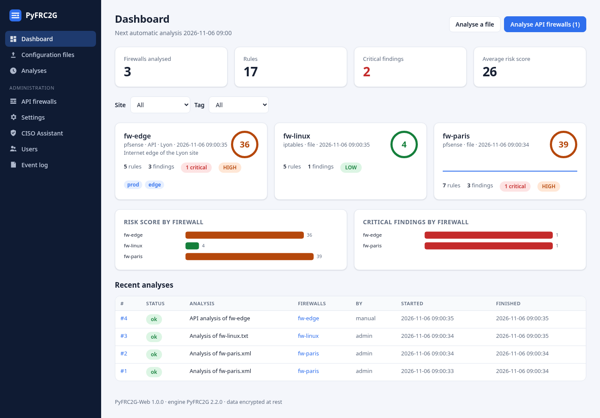
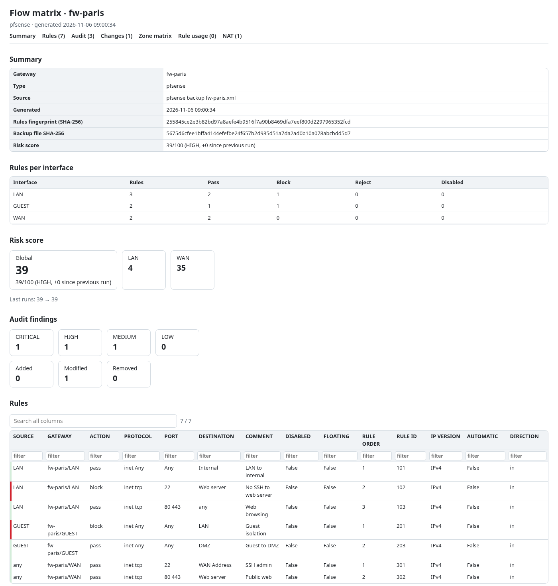
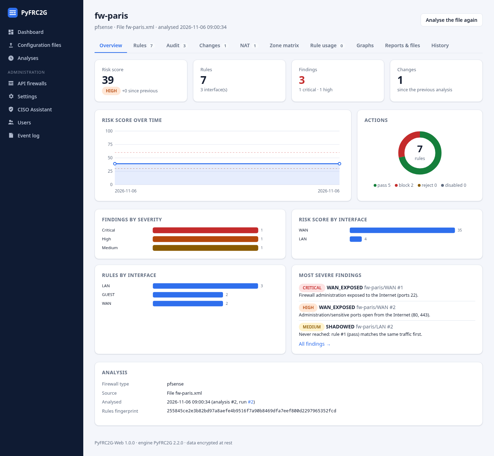
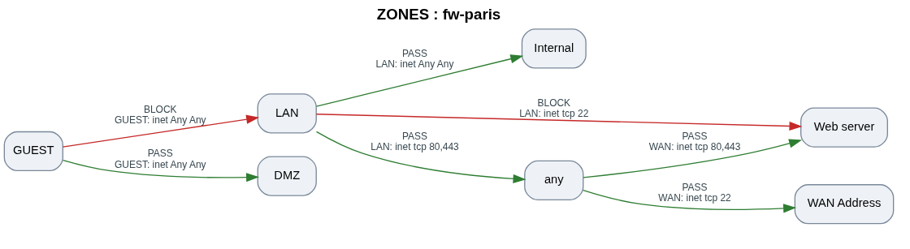

# PyFRC2G - Unified Firewall Rules to Graph Converter

Convert firewall rules into graphical flow diagrams, audit and compliance reports:
**pfSense** and **OPNsense** (API or XML backup), **FortiGate**, **iptables**, **nftables** and
**Stormshield** (configuration files).


| Web application | Interactive HTML report |
|:---:|:---:|
| [](./img/web-dashboard.png) | [](./img/html-report.png) |
| [](./img/web-firewall-overview.png) | [](./img/zones-graph.png) |

## 📦 Repository content

| Folder | Package | What it is |
|--------|---------|------------|
| [`engine/`](engine/) | `pyfrc2g` | The engine and the command line tool: parsers, audit, change report, compliance policy, risk score, zone matrix, graphs, PDF / HTML / Excel / CSV reports, CISO Assistant upload. **Everything you need without a web interface.** |
| [`web/`](web/) | `pyfrc2g-web` | The web application (Flask): dashboard, charts and graphs per firewall, API firewalls configuration, uploads, users and roles, data encrypted in SQLite. Uses the engine. |

Full documentation: [`engine/README.md`](engine/README.md) and [`web/README.md`](web/README.md).

## 🚀 Quick start

### Command line (engine)

```bash
git clone https://github.com/olivierb46/PyFRC2G.git
cd PyFRC2G/engine
pip install .                        # Graphviz must be installed on the system
pyfrc2g --backup config.xml          # reports in results/<firewall>/
```

Without cloning: `pip install "pyfrc2g @ git+https://github.com/olivierb46/PyFRC2G.git#subdirectory=engine"`.
Docker image of the command line: see [`engine/Dockerfile`](engine/Dockerfile).

### Web application

```bash
git clone https://github.com/olivierb46/PyFRC2G.git
cd PyFRC2G/web
cp .env.example .env                 # PYFRC2G_SECRET_KEY, PYFRC2G_ADMIN_USER / PYFRC2G_ADMIN_PASSWORD
docker compose up -d --build         # http://localhost:8080
```

Without Docker, from the repository root: `pip install ./engine ./web`, then `pyfrc2g-web`.

## 📄 License

MIT, see [LICENSE](LICENSE).
