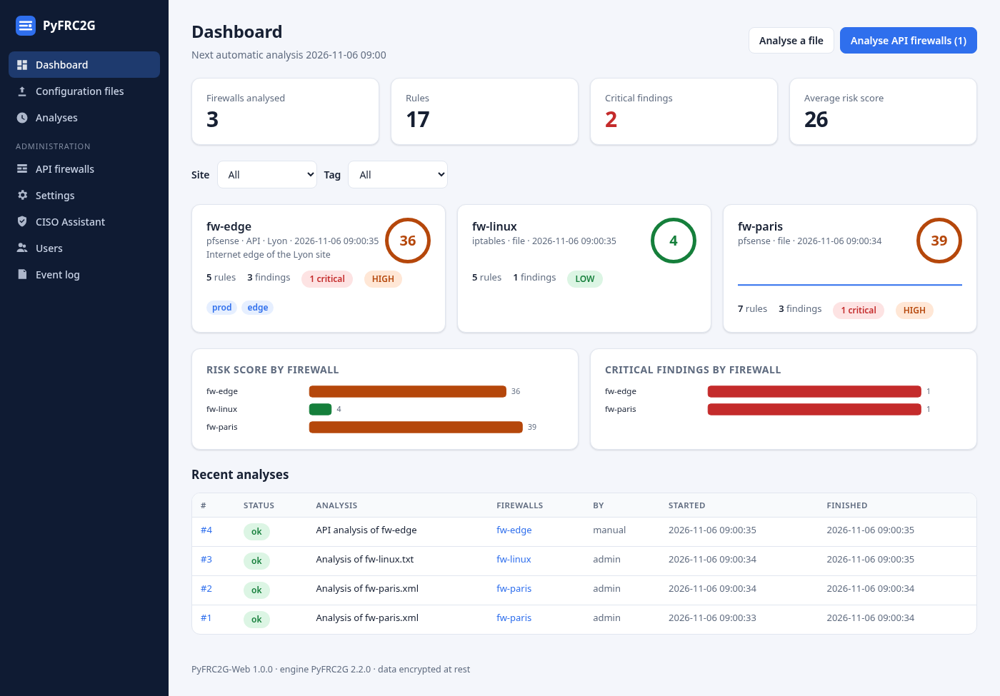
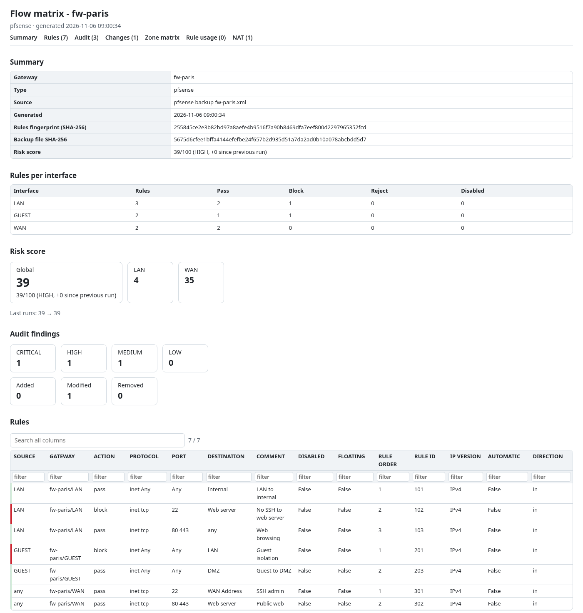
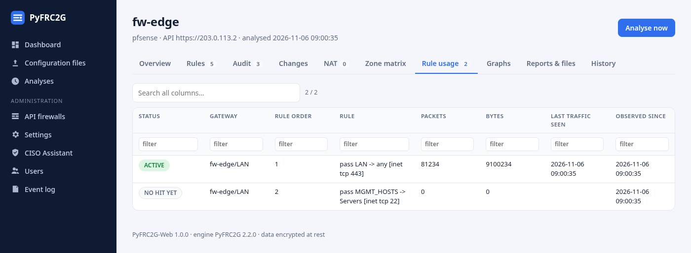
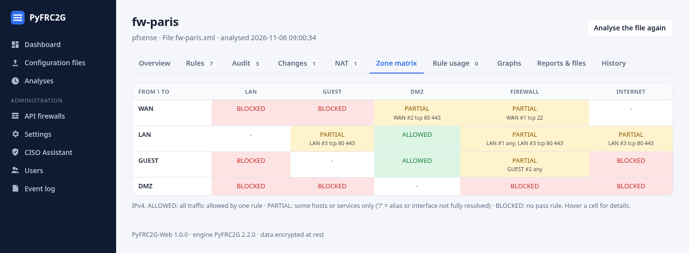
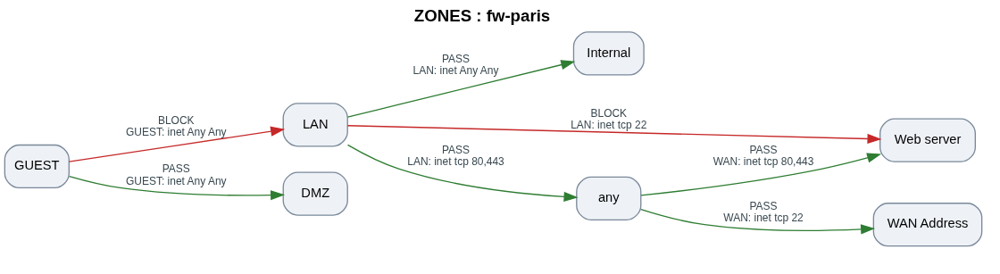

# PyFRC2G - Unified Firewall Rules to Graph Converter

Unified Python package to convert firewall rules into graphical flow diagrams, audit and
compliance reports: **pfSense** and **OPNSense** (API or XML backup), **FortiGate**, **iptables**,
**nftables** and **Stormshield** (configuration files).


**Quick start:** Configure `pyfrc2g/config.py` (or a `.env` file) then run `pyfrc2g` or `python -m pyfrc2g` (API mode), or run `pyfrc2g --backup config.xml` to use a backup / configuration file without API config.

## 👋 Overview

PyFRC2G was designed to meet two main objectives:

* **Visual Documentation**: Provide a global graphical view of firewall rules (a picture is worth a thousand words)
* **Compliance Evidence**: Provide evidence to meet IT security requirements defined in various compliance frameworks

## ⚡ Features

### Core Features

* **Two Input Modes**: Fetch rules via **API** (pfSense/OPNSense) or read from a **backup / configuration file**
* **Several Firewall Types**: pfSense, OPNsense, FortiGate, iptables (`iptables-save`), nftables (`nft -j list ruleset`), Stormshield (experimental); format detected automatically
* **Secrets out of the code**: every setting can come from environment variables or a `.env` file, `${VAR}` references in `FIREWALLS`
* **TLS verification**: `--verify-ssl`, `--ca-bundle` (internal CA), per-firewall settings
* **Automatic Interface Detection**: Auto-detects all available interfaces for OPNSense
* **API-Based Alias Mapping**: Retrieves all aliases from firewall API or from the backup XML
* **Per-Interface Output**: Generates separate CSV and PDF files for each interface
* **Several Firewalls per Run**: `FIREWALLS` list in the config (API) or several `--backup` files
* **NAT**: port forwards, outbound (source) NAT and 1:1 NAT in the PDF, HTML and Excel reports (`--no-nat` to skip)
* **Change Report**: Rules added / modified / removed since the previous run (CSV, PDF, HTML, Excel), with history of previous snapshots
* **Risk Detection (audit)**: any-to-any rules, admin/sensitive ports exposed on the WAN, shadowed, redundant or partially overlapping rules (aliases and interface networks expanded), disabled rules, rules without description
* **Unused Rules**: rule hit counters (pfctl, OPNsense API, iptables/nft counters) tracked over time to report rules without traffic for N days
* **Compliance Policy**: your own rules in a YAML/JSON file ("no RDP from the WAN", "the guest network must not reach the LAN"...), reported in the audit
* **Risk Score**: 0-100 score per firewall and per interface, with its evolution between runs
* **Zone Matrix**: interface × interface table (allowed / blocked / partial)
* **Firewall Comparison**: `--compare fw1.xml fw2.xml` (CARP primary/secondary, pre-production/production)
* **IPv4 / IPv6**: `IP VERSION` column and `--ip-version 4|6` filter
* **Web application**: in the [`web/`](../web/) folder of this repository (dashboard, charts, graphs, encrypted storage), uses this package as its engine
* **Scheduled mode** (`--every 6h`) and **Docker image** with Graphviz included
* **Exports**: self-contained filterable HTML report and Excel workbook, in addition to PDF/CSV
* **Smart Change Detection**: Only regenerates outputs when rules have changed (SHA-256 fingerprint, `--force` to override)
* **Configuration Check**: Validates `pyfrc2g/config.py` before API mode (optional bypass with `--skip-config-check`)
* **Modular Architecture**: Clean, maintainable, and extensible codebase

### Technical Features

* **Graphical Flows**: Generates visual flow diagrams using Graphviz
* **Vector PDF**: Graphs rendered directly to PDF (sharp at any zoom, searchable text); `--raster` for the former PNG-on-A4 layout
* **Summary Page**: First page of each PDF with metadata, fingerprints, rules per interface/action, audit and change counts
* **Zones View**: Network-centric graph (source zone → destination zone, aggregated services), in addition to the per-rule view
* **Color Coding**: 
  - 🟢 Green for PASS rules
  - 🔴 Red for BLOCK rules
  - 🟡 Yellow for disabled rules
* **Network Mapping**: Distinguishes between VLANs/networks and destination hosts
* **Comprehensive Coverage**: Handles floating rules, disabled rules, and all interface types
* **CISO Assistant Integration**: Optional automatic upload of PDFs to CISO Assistant as evidence revisions

## 📋 Prerequisites

### Python Requirements

- Python 3.9 or higher
- Required packages (see Installation)

### System Requirements

- **Graphviz**: Must be installed on your system
  - **Windows**: Download from [Graphviz website](https://graphviz.org/download/)
  - **Linux**: `sudo apt-get install graphviz` (Debian/Ubuntu) or `sudo yum install graphviz` (RHEL/CentOS)
  - **macOS**: `brew install graphviz`

### Firewall API Setup (API mode only)

#### pfSense

1. Install **pfSense REST API Package**: [pfSense REST API Documentation](https://github.com/jaredhendrickson13/pfsense-api?tab=readme-ov-file#quickstart)
2. Configure the listening interface(s) on pfSense
3. Generate an API key for authentication
4. Optional, for unused rule detection through the API: give the key access to
   `POST /api/v2/diagnostics/command_prompt` and set `"hits": "api"` (it runs `pfctl -vvsr`);
   otherwise provide a `pfctl -vvsr` output file with `--hits`

#### OPNSense

1. Create API credentials in OPNSense:
   - Go to **System > Access > Users**
   - Create or edit a user
   - Generate API key and secret in **API Keys** section
2. Hit counters are read from `/api/firewall/filter_util/rule_stats` when available

### Configuration Files (backup mode)

| Firewall | File to give to `--backup` |
|----------|----------------------------|
| pfSense / OPNsense | `config.xml` (Diagnostics > Backup & Restore / System > Configuration > Backups) |
| FortiGate | Full configuration backup (`.conf`, or `show full-configuration` output) |
| iptables | `iptables-save -c > rules.txt` (or `ip6tables-save -c`); `-c` adds hit counters |
| nftables | `nft -j list ruleset > ruleset.json` |
| Stormshield (experimental) | Extracted configuration directory (with `ConfigFiles/Filter/` and `ConfigFiles/object`) or one filter slot file |

## 💾 Installation

### Option 1: Install as Package (Recommended)

```bash
# Clone the repository (the engine is in the engine/ folder)
git clone https://github.com/olivierb46/PyFRC2G.git
cd PyFRC2G/engine

# Install in development mode
pip install -e .

# Or install directly
pip install .
```

Without cloning (git required):

```bash
pip install "pyfrc2g @ git+https://github.com/olivierb46/PyFRC2G.git@v2.2.0#subdirectory=engine"
```

### Option 2: Direct Usage

```bash
cd PyFRC2G/engine
# Install dependencies
pip install -r requirements.txt

# Use the script directly
python pyfrc2g.py
```

### Option 3: Docker (Graphviz included)

```bash
docker build -t pyfrc2g .

# One-shot analysis of a backup, results in ./results
docker run --rm --user "$(id -u):$(id -g)" -v "$PWD:/data" pyfrc2g --backup config.xml

# Scheduled API analysis every 6 hours (credentials in .env, see examples/env.example)
cp examples/env.example .env
docker compose up -d --build
```

The image runs as an unprivileged user (uid 10001) in `/data` (results go to
`/data/results/`) and stops cleanly on `docker stop`. When mounting a host directory, add
`--user "$(id -u):$(id -g)"` so that the generated files belong to you (rootless podman:
`--userns=keep-id --user "$(id -u):$(id -g)"`).

Several firewalls: put the list in a YAML/JSON file (see
[`examples/firewalls.example.yml`](examples/firewalls.example.yml)), mount it and set
`PYFRC2G_FIREWALLS_FILE` (commented lines in `docker-compose.yml`).

## 🌐 Web Application



The web interface is in the **[`web/`](../web/)** folder of this repository (package
`pyfrc2g-web`): dashboard and charts per firewall, Graphviz graphs in the browser, reports, API
firewalls configuration, uploads of configuration files, users and roles, and all the data
stored encrypted in SQLite. It uses this package (the engine); command line users do not need
it. See [`web/README.md`](../web/README.md).

## ⏱️ Scheduled Mode

`--every DURATION` (`300`, `30m`, `6h`, `1d`, or `PYFRC2G_SCHEDULE`) repeats the run until
the process is stopped; combined with the normal change detection, reports are regenerated
only when the rules (or the rule usage statuses) change.

```bash
pyfrc2g --api --every 6h
```

## ⚙️ Configuration

Configuration is required only for **API mode**. When using `--backup`, no API config is needed.

### Environment variables and `.env` file

Secrets do not have to be written in `pyfrc2g/config.py`. At startup PyFRC2G reads a `.env` file
in the current directory (or the file given with `--env-file`); real environment variables win
over the file. Start from [`examples/env.example`](examples/env.example):
`cp examples/env.example .env && chmod 600 .env`.

```bash
# .env (keep it out of git: chmod 600 .env)
PYFRC2G_GATEWAY_TYPE=pfsense
PYFRC2G_PFS_URL=https://pfs01.domain.lan
PYFRC2G_PFS_TOKEN=xxxxxxxx
PYFRC2G_VERIFY_SSL=true
FW_LYON_SECRET=yyyyyyyy          # referenced from FIREWALLS as "${FW_LYON_SECRET}"
```

| Variable | Configuration value |
|----------|---------------------|
| `PYFRC2G_GATEWAY_TYPE`, `PYFRC2G_GATEWAY_NAME` | `GATEWAY_TYPE`, `GATEWAY_NAME` |
| `PYFRC2G_PFS_URL`, `PYFRC2G_PFS_TOKEN` | `PFS_BASE_URL`, `PFS_TOKEN` |
| `PYFRC2G_OPNS_URL`, `PYFRC2G_OPNS_KEY`, `PYFRC2G_OPNS_SECRET` | `OPNS_BASE_URL`, `OPNS_KEY`, `OPNS_SECRET` |
| `PYFRC2G_INTERFACES`, `PYFRC2G_WAN_INTERFACES` | `INTERFACES`, `WAN_INTERFACES` (comma-separated) |
| `PYFRC2G_VERIFY_SSL`, `PYFRC2G_CA_BUNDLE` | `VERIFY_SSL`, `CA_BUNDLE` |
| `PYFRC2G_UNUSED_DAYS`, `PYFRC2G_POLICY_FILE` | `UNUSED_DAYS`, `POLICY_FILE` |
| `PYFRC2G_CISO_URL`, `PYFRC2G_CISO_TOKEN`, `PYFRC2G_CISO_FOLDER_ID`, `PYFRC2G_CISO_EVIDENCE_ID` | CISO Assistant settings |

Any string of `FIREWALLS` may contain `${NAME}`: the configuration check reports variables that
are not set.

### 1. Edit Configuration File

Edit `pyfrc2g/config.py` to configure your gateway:

#### For pfSense:

```python
GATEWAY_TYPE = "pfsense"

PFS_BASE_URL = "https://pfs01.domain.lan"
PFS_TOKEN = "YOUR_API_KEY_GENERATED_WITH_PFSENSE_REST_API"

GATEWAY_NAME = "PFS01"
```

#### For OPNSense:

```python
GATEWAY_TYPE = "opnsense"

# OPNSense Configuration
OPNS_BASE_URL = "https://opnsense.domain.lan"
OPNS_KEY = "YOUR_API_KEY"
OPNS_SECRET = "YOUR_API_SECRET"

# Option 1: Auto-detection (recommended)
INTERFACES = []  # Leave empty for automatic detection

# Option 2: Manual specification
INTERFACES = ["wan", "lan", "opt1", "opt2"]

GATEWAY_NAME = "OPNS01"  # Display name for gateway (used in labels)
```

#### Several firewalls

To process several firewalls in one run (API mode), fill the `FIREWALLS` list. When it is
non-empty, it replaces the single-firewall variables above:

```python
FIREWALLS = [
    {"name": "fw-paris", "type": "pfsense", "url": "https://10.0.0.1", "token": "${FW_PARIS_TOKEN}",
     "hits": "api"},
    {"name": "fw-lyon", "type": "opnsense", "url": "https://10.1.0.1",
     "key": "${FW_LYON_KEY}", "secret": "${FW_LYON_SECRET}", "interfaces": ["lan", "opt1"],
     "ca_bundle": "/etc/ssl/internal-ca.pem"},
]
```

Optional per-firewall keys: `ciso_evidence_id` (upload to a specific CISO Assistant evidence),
`verify_ssl` / `ca_bundle` (TLS), `hits` (`"api"` or path to a `pfctl -vvsr` output file),
`interfaces` (only these interfaces are analysed, floating rules included), `timeout` (API
requests, seconds), `interface_labels` (`{"opt1": "DMZ"}`), `wan_interfaces` / `admin_ports` /
`sensitive_ports` / `unused_days` (override the audit settings for this firewall) and `meta`
(`{"Site": "Paris", "Owner": "NetOps"}`, shown in the reports).
Each firewall is processed independently: a failure on one does not stop the others.

#### TLS

```python
VERIFY_SSL = False   # historical default: self-signed certificates accepted (a warning is logged)
CA_BUNDLE = None     # PEM file of your internal CA; setting it enables verification
```

`--verify-ssl` and `--ca-bundle FILE` override these values for one run. The CISO Assistant
upload uses the same global settings.

#### Audit settings

```python
WAN_INTERFACES = ["wan"]          # Internet-facing interfaces (ids, descriptions, iptables -i names)
ADMIN_PORTS = [22, 23, 80, 443, 161, 3389, 5900, 8080, 8443, 10443]
SENSITIVE_PORTS = [135, 139, 445, 1433, 1521, 2049, 3306, 5432, 6379, 9200, 11211, 27017]
UNUSED_DAYS = 30                  # report rules without traffic for this many days
POLICY_FILE = None                # compliance policy (YAML or JSON), or --policy FILE
RISK_WEIGHTS = {"CRITICAL": 25, "HIGH": 10, "MEDIUM": 4, "LOW": 1}
```

#### Compliance policy

A commented example covering every condition is provided in
[`examples/policy.example.yml`](examples/policy.example.yml) (Internet exposure, segmentation,
rule hygiene): copy it, adapt the interface names, then run
`pyfrc2g --backup config.xml --policy my-policy.yml`.

A policy file lists rules that the configuration must respect. A rule matching every `match`
condition is a violation; with a `require` block, the violation is a matching rule that does
not satisfy `require`. Violations appear in the audit as `POLICY:<id>`.

```yaml
policies:
  - id: no-rdp-from-wan
    description: RDP must never be reachable from the Internet
    severity: CRITICAL
    match: {interface: wan, action: pass, port: 3389}

  - id: guest-isolated-from-lan
    description: The guest network must not reach the LAN
    severity: HIGH
    match: {interface: GUEST, action: pass, destination: lan}

  - id: pass-needs-description
    description: Every pass rule must be documented
    severity: LOW
    match: {action: pass}
    require: {comment: ".+"}
```

Conditions (a list means "any of", a `!` prefix negates): `interface` (id or description),
`action`, `protocol`, `port` (port, range or alias: matches when the rule can reach it),
`source` / `destination` (IP, network, alias or interface: matches when the sets intersect),
`comment` (regular expression), `disabled` (disabled rules are ignored unless set), `floating`,
`automatic` (rules generated by the firewall are ignored unless set),
`ip_version`, `gateway` (text in the GATEWAY column). JSON files use the same structure.

### 2. Configuration Check (API Mode)

Before running in API mode, the tool checks for each firewall that the URL and credentials (`token` for pfSense, `key`/`secret` for OPNSense) are not left as placeholders. An invalid firewall is skipped with an error (exit code 2). Use `--skip-config-check` to bypass (e.g. in scripts).

### 3. CISO Assistant Integration (Optional)

If you want to automatically upload generated PDFs to CISO Assistant as evidence revisions, configure the following in `pyfrc2g/config.py`:

```python
# CISO Assistant Configuration
CISO_URL = "https://ciso-assistant.example.com"
CISO_TOKEN = "YOUR_CISO_ASSISTANT_API_TOKEN"
CISO_EVIDENCE_PATH = f"{CISO_URL}/api/evidence-revisions/"
CISO_FORLDER_ID = "<CISO_FOLDER_ID>"  # Folder ID from CISO Assistant to which the evidence is linked.
CISO_EVIDENCE_ID = "<CISO_EVIDENCE_ID>"  # Evidence ID from CISO Assistant.
```

**Note:** Leave these as default values (`<CISO_ASSISTANT_ADDRESS>`, etc.) to disable CISO Assistant integration.

### 4. Aliases (API Mode)

**In API mode, the package automatically retrieves all aliases from the firewall API:**
- Interface names and descriptions
- Network aliases
- Address aliases
- Port aliases

No manual alias mapping is required. In **backup mode**, aliases are read from the XML file.

## 🚀 Usage

### Command-Line Options (argparse)

| Option | Short | Description |
|--------|-------|-------------|
| `--api` | `-a` | Fetch rules from firewall API (default if no mode) |
| `--backup FILE [FILE ...]` | `-b` | Read rules from one or several configuration files (see [Configuration Files](#configuration-files-backup-mode)) |
| `--compare A B` | | Compare the rules, aliases and NAT of two configuration files |
| `--format FORMAT` | | `auto` (default), `pfsense`, `opnsense`, `fortigate`, `iptables`, `nftables`, `stormshield` |
| `--gateway-name NAME` | `-g` | Gateway display name (single firewall/backup only) |
| `--output-dir DIR` | `-o` | Base output directory (default `results`); files go to `DIR/<gateway>/` |
| `--force` | `-f` | Regenerate outputs even if no rule changed |
| `--interfaces LIST` | `-i` | Only these interfaces, e.g. `lan,opt1` (floating rules are kept) |
| `--view {all,rules,zones}` | | Graphs to include (default `all`) |
| `--raster` | | PNG graphs on A4 pages instead of vector PDF |
| `--ip-version {4,6}` | | Only rules that apply to IPv4 or IPv6 |
| `--no-nat` | | Do not include NAT rules |
| `--no-excel` | | Do not write the Excel workbook |
| `--no-automatic-rules` | | Leave out the rules generated by the firewall itself (OPNsense API) |
| `--policy FILE` | | Compliance policy (YAML or JSON) |
| `--hits FILE` | | Rule hit counters: `pfctl -vvsr` output file, or `api` (pfSense command prompt endpoint) |
| `--no-hits` | | Do not read hit counters |
| `--unused-days N` | | Report rules without traffic for N days (default 30) |
| `--env-file FILE` | | Load variables from this file instead of `./.env` |
| `--verify-ssl` | | Verify TLS certificates |
| `--ca-bundle FILE` | | CA certificates used for verification (implies `--verify-ssl`) |
| `--every DURATION` | | Run again every DURATION (`30m`, `6h`, `1d`) until stopped |
| `--skip-config-check` | | Skip configuration check before API mode |
| `--check-deps` | | Check that required Python packages are installed |
| `--debug` | `-d` | Enable debug logging |
| `--verbose` | `-v` | Verbose output (same as --debug) |

### Basic Usage

#### Mode API (default)

Configure `pyfrc2g/config.py`, then run:

```bash
pyfrc2g
# or explicitly
pyfrc2g --api
```

Before running, a **configuration check** ensures that API URL and credentials are set. If the config is still using placeholders, the tool exits with a clear message. Use `--backup` to work without API config, or `--skip-config-check` to bypass (not recommended).

#### Mode Backup / configuration file

Use a pfSense or OPNSense backup file (e.g. from Diagnostics > Backup & Restore), or a FortiGate,
iptables, nftables or Stormshield configuration. No API config needed.

```bash
pyfrc2g --backup config-backup.xml

# Optional: set gateway name (otherwise derived from filename)
pyfrc2g --backup config-backup.xml --gateway-name my-firewall
```

The tool detects the format automatically (`--format` to force it) and reads rules, objects /
aliases, interface addresses and NAT. Reports are generated the same way as in API mode.

#### Comparison of two firewalls

```bash
pyfrc2g --compare fw-primary.xml fw-secondary.xml -o /srv/audit
```

Writes `compare_<A>_vs_<B>.csv`, `.html` and `.pdf`: rules only in A, only in B or different
(matched by interface + rule ID when both share identifiers, as with pfSense CARP sync,
otherwise by content), aliases and NAT rules.

#### Other Examples

```bash
# Debug / verbose
pyfrc2g --api --debug
pyfrc2g --backup config.xml --verbose

# Bypass config check (e.g. in scripts)
pyfrc2g --api --skip-config-check

# Several backups (any supported format), custom output directory
pyfrc2g --backup fw1.xml fortigate.conf ruleset.json --output-dir /srv/audit

# Only LAN and OPT1, zones view only, regenerate even without change
pyfrc2g --interfaces lan,opt1 --view zones --force

# Compliance policy and unused rules (pfctl -vvsr output saved on the firewall)
pyfrc2g --backup config.xml --policy examples/policy.example.yml --hits pfctl-vvsr.txt

# IPv6 rules only, certificates verified against an internal CA
pyfrc2g --api --ip-version 6 --ca-bundle /etc/ssl/internal-ca.pem
```

#### As an Installed Package:

```bash
pyfrc2g
pyfrc2g --backup config.xml
```

#### As a Python Module:

```python
from pyfrc2g.main import main

# Option 1: Use the main function (same arguments as the CLI)
main(["--backup", "config.xml", "--output-dir", "out"])

# Option 2: Use components directly
from pyfrc2g.analysis.audit import audit_rules
from pyfrc2g.config import Config
from pyfrc2g.inputs.api_client import APIClient
from pyfrc2g.model.rules import build_rule_rows

config = Config()
api_client = APIClient(config)
api_client.fetch_aliases()
rows = build_rule_rows(api_client.fetch_rules(), config)
findings = audit_rules(rows, config)
```

### What the Script Does

**Mode API**
1. Loads `.env` / environment variables, runs a configuration check (unless `--skip-config-check`)
2. Connects to your gateway (pfSense or OPNSense), TLS verified if configured
3. Fetches aliases, interfaces (with their addresses), firewall rules, NAT rules and hit counters
4. Auto-detects interfaces (if not specified)

**Mode Backup**
1. Detects the format and parses rules, objects, interface addresses and NAT
2. No API call; gateway type and name come from the file or `--gateway-name`

**Common steps**
5. Normalizes rules and NAT, optionally filtered with `--interfaces` / `--ip-version`
6. Updates the hit counter history (`hits_history.json`)
7. Compares with the previous run (SHA-256 fingerprint); stops here if nothing changed (unless `--force` or backup mode)
8. Builds the change report against the previous snapshot (archived in `history/`)
9. Runs the audit checks, the compliance policy and the unused rule detection, computes the risk score and the zone matrix
10. Generates graphs (Graphviz) and PDFs (ReportLab + pypdf), HTML report and Excel workbook
11. Uploads the global PDF to CISO Assistant (if configured)

### Generated Files



The script generates files in `results/<GATEWAY_NAME>/` (or `--output-dir`):

#### Global Files:
- `<GATEWAY_NAME>_FLOW_MATRIX.pdf` - Summary (with risk score), changes, audit, zone matrix, rule usage, NAT, zones view, then one page per interface (with bookmarks)
- `<GATEWAY_NAME>_REPORT.html` - Self-contained report with filterable tables (rules, audit, changes, zone matrix, rule usage, NAT) and risk score
- `<GATEWAY_NAME>_FLOW_MATRIX.xlsx` - Excel workbook (Summary, Rules, Audit, Changes, Zone matrix, Rule usage, NAT sheets)
- `<GATEWAY_NAME>_ALL_flows.csv` - All rules (also the snapshot used by the next change report)
- `<GATEWAY_NAME>_AUDIT.csv` - Audit findings (including policy violations and unused rules)
- `<GATEWAY_NAME>_CHANGES.csv` - Changes since the previous run (from the second run on)
- `<GATEWAY_NAME>_MATRIX.csv` - Zone matrix (pfSense, OPNsense, FortiGate)
- `<GATEWAY_NAME>_HITS.csv` - Rule usage (when hit counters are available)
- `<GATEWAY_NAME>_NAT.csv` - NAT rules (when present)

#### Per-Interface Files:
- `<GATEWAY_NAME>_<interface>_flows.csv` - CSV file with rules for specific interface
- `<GATEWAY_NAME>_<interface>_FLOW_MATRIX.pdf` - Summary, zones view and graph for specific interface

#### Tracking:
- `fingerprint.txt` - SHA-256 of the last generated rules + NAT + rule usage statuses (change detection)
- `history/` - Previous `_ALL_flows.csv` snapshots, timestamped
- `hits_history.json` - First observation and last traffic seen for each rule
- `risk_history.json` - Risk score of the last 100 runs

### Example Output Structure

```
results/PFS01/
├── PFS01_FLOW_MATRIX.pdf              # Global PDF
├── PFS01_REPORT.html                  # Filterable HTML report
├── PFS01_FLOW_MATRIX.xlsx             # Excel workbook
├── PFS01_ALL_flows.csv                # All rules
├── PFS01_AUDIT.csv                    # Audit findings
├── PFS01_CHANGES.csv                  # Change report
├── PFS01_MATRIX.csv                   # Zone matrix
├── PFS01_HITS.csv                     # Rule usage
├── PFS01_NAT.csv                      # NAT rules
├── PFS01_WAN_FLOW_MATRIX.pdf          # WAN interface PDF
├── PFS01_WAN_flows.csv                # WAN interface CSV
├── PFS01_LAN_FLOW_MATRIX.pdf          # LAN interface PDF
├── PFS01_LAN_flows.csv                # LAN interface CSV
├── fingerprint.txt
├── hits_history.json
├── risk_history.json
└── history/
    └── PFS01_ALL_flows_20261105-134003.csv
```

## 📊 Output Format

### CSV Columns

The global and per-interface CSV files use the same columns for every firewall type:

| Column      | Description |
|------------|-------------|
| SOURCE     | Source network or address (mapped from API aliases when available) |
| GATEWAY    | Gateway name and interface(s), e.g. `OPNS01/wan,lan` or `OPNS01/Floating-rules` |
| ACTION     | Pass, block, reject (mapped to display value) |
| PROTOCOL   | IP layer and protocol: `IPv4 tcp`, `IPv6 udp`, `IPv4+IPv6 Any`, etc. Empty protocol is shown as `Any`. |
| PORT       | Destination port or range |
| DESTINATION| Destination network or address |
| COMMENT    | Rule description |
| DISABLED   | True / False |
| FLOATING   | True for floating rules |
| RULE ORDER | Rule order index |
| RULE ID    | Stable rule identifier (pfSense tracker, OPNsense uuid, FortiGate policy uuid, content hash for iptables / nftables / Stormshield), used by the change report |
| IP VERSION | `IPv4`, `IPv6` or `IPv4+IPv6` |
| DIRECTION  | `in`, `out` or `any`: pf direction of the rule (OPNsense API, floating rules) |
| AUTOMATIC  | `True` for a rule generated by the firewall itself (OPNsense automatic rules returned by the API: default deny, anti-lockout, DHCP, bogons, IPv6 ICMP...) |

For iptables / nftables the GATEWAY interface part is the chain (`INPUT`, `FORWARD`, user
chains); input / output interface conditions and connection states are shown in COMMENT.
The chain policy is added as the last rule of each built-in chain.

### NAT Columns

`TYPE` is `PORT FORWARD` (DESTINATION / DESTINATION PORT rewritten to TARGET / TARGET PORT),
`OUTBOUND` (SOURCE leaves with address TARGET: `Interface address`, an IP, or `No NAT`) or `1:1`
(SOURCE internal address <-> TARGET external address). The pfSense outbound NAT mode is shown
on the summary page.

### Audit Checks

| Check | Severity | Description |
|-------|----------|-------------|
| ANY_ANY | CRITICAL / MEDIUM | Pass rule from any source to any destination (all ports / specific ports) |
| WAN_EXPOSED | CRITICAL / HIGH | Pass rule from any source on a WAN interface: firewall administration ports, admin/sensitive ports, or all ports |
| SHADOWED | MEDIUM | Rule never reached: an earlier rule on the same interface matches the same traffic with another action |
| REDUNDANT | LOW | Rule fully covered by an earlier rule with the same action |
| PARTIAL_OVERLAP | LOW | Part of the traffic of the rule is decided earlier by a rule with another action |
| UNUSED | MEDIUM | No packet matched since the first observation, for at least `UNUSED_DAYS` days |
| NO_RECENT_TRAFFIC | LOW | Packet counter unchanged for at least `UNUSED_DAYS` days |
| DISABLED | LOW | Disabled rule still present |
| NO_DESCRIPTION | LOW | Rule without description |
| POLICY:&lt;id&gt; | from the policy | Compliance policy violation |

Shadowing and overlap analysis expands aliases (nested ones too), interface networks
(`LAN net`), firewall addresses, IP ranges and port aliases, and compares IPv4 / IPv6
separately. When a value cannot be resolved (FQDN or URL alias, DHCP interface) the analysis
stays conservative: no finding rather than a false one. Floating rules are skipped
(last-match semantics by default).

### Automatic Rules (OPNsense API)

Through the API, OPNsense also returns the rules it generates itself (default deny, anti-lockout,
DHCP / DHCPv6, bogons and private networks on the WAN, IPv6 ICMP requirements, port 0,
sshlockout / virusprot tables, traffic of the firewall itself). They are never stored in
`config.xml`, which is why a backup shows fewer rules than the API. They are marked
`AUTOMATIC=True` (OPNsense `is_automatic` flag, or their 32-character hexadecimal id; user
rules have a UUID). Rules without action are shown as `pass` (pf default), empty addresses
and ports as `Any`. They get no audit finding of their own and are ignored by the compliance
policy unless it asks for them; they still count when they shadow a rule and in the zone
matrix, because they do decide the traffic. `--no-automatic-rules` leaves them out, to compare an API analysis with a
backup.

### Unused Rules



pf counters (`Evaluations`, `Packets`, `Bytes`, `States`) are reset when the ruleset is
reloaded or the firewall reboots, so one reading is not enough: each run updates
`hits_history.json` and a rule is reported only when its packet counter has not moved for
`UNUSED_DAYS` days of observation. Run PyFRC2G regularly (cron) to build this history.

Counter sources: `--hits pfctl.txt` (output of `pfctl -vvsr`, matched by pfSense tracker /
`ridentifier` or by label), `"hits": "api"` for pfSense, OPNsense API (automatic, best effort),
`iptables-save -c` and nftables `counter` statements.

**pfSense**: neither the configuration backup nor the REST API rule endpoints carry counters, so
they are never read by default. Two ways to get them:

```bash
# API mode: runs "pfctl -vvsr" through POST /api/v2/diagnostics/command_prompt
# (the API key needs the privilege of that endpoint)
pyfrc2g --api --hits api
# Backup mode: save the output of "pfctl -vvsr" (Diagnostics > Command Prompt) to a file
pyfrc2g --backup config.xml --hits pfctl-vvsr.txt
```

In the web application, tick *Read rule hit counters through the API* on the firewall. When no
counters are available, the reports say why and how to get them.

### Risk Score

`score = 25 × CRITICAL + 10 × HIGH + 4 × MEDIUM + LOW` (LOW findings count for 10 points at most),
capped at 100, globally and per interface. Levels: 0-9 LOW, 10-29 MODERATE, 30-59 HIGH,
60+ CRITICAL. The summary shows the difference with the previous run.

### Zone Matrix



For each source interface and each destination zone (other interfaces, `Firewall`, `Internet`):

- **ALLOWED**: one rule allows all traffic
- **PARTIAL**: only some hosts or services (rule numbers and services listed; `?` when an alias or interface network is not fully resolved)
- **BLOCKED**: no pass rule reaches the zone (explicit block or default deny)

IPv4 only. Rules are evaluated like pf does: OPNsense rules in their real order (`sort_order`,
floating and interface rules mixed), pfSense floating rules first; outbound (`out`) rules are
ignored, and a non-quick rule (OPNsense default deny, pfSense floating rule without "quick")
only decides when no quick rule matches. Rule references show their group (`LAN #11`,
`Floating #7`) because numbers restart in each group; a PARTIAL cell lists the rules that block
part of the traffic. Available for pfSense, OPNsense and FortiGate (rules bound to an ingress
interface);
FortiGate egress interfaces (`dstintf`) are taken into account and the `Firewall` column is
omitted (local-in policies are not analysed).

Zones view (`--view zones`, also in the PDF and the web application):



### PDF Content

The global PDF contains (each section is a bookmark):

- **Summary page**: gateway, type, source, date, SHA-256 fingerprints, risk score (global and per interface), rules per interface/action, audit and change counts
- **Changes**, **Audit findings**, **Zone matrix**, **Rule usage** and **NAT rules** tables
- **Zones view**: one node per source/destination, one arrow per flow (green pass, red block, dashed disabled)
- **One page per interface** with flow diagrams
- **One page for floating rules** when applicable
- **Graphical flow diagrams** showing:
  - **Sources**: Network/host sources
  - **Gateway/Interface**: Firewall interface name
  - **Actions**: PASS (green) / BLOCK (red) with color coding
  - **Protocols**: IP protocol (e.g. IPv4 tcp, IPv6 Any)
  - **Ports**: Destination ports or port ranges
  - **Destinations**: Network/host destinations
  - **Comments**: Rule descriptions
  - **Disabled Rules**: Highlighted in yellow

## 🏗️ Project Structure

```
PyFRC2G/
├── engine/                        # This package (PyFRC2G engine and command line)
│   ├── pyfrc2g/                   # Main package
│   │   ├── __init__.py                # Version and public helpers
│   │   ├── __main__.py / main.py      # Entry points (python -m pyfrc2g, console script "pyfrc2g")
│   │   ├── cli.py                     # Command line, settings, loop over firewalls
│   │   ├── pipeline.py                # load -> rows -> analysis -> outputs for one firewall; --compare
│   │   ├── config.py                  # User configuration (+ .env / PYFRC2G_* variables)
│   │   ├── config_checker.py          # Validation of the API targets
│   │   ├── utils.py                   # Alias maps, value mapping, small helpers
│   │   ├── inputs/                    # Where the rules come from
│   │   │   ├── __init__.py            #   format detection, load_backup()
│   │   │   ├── api_client.py          #   pfSense / OPNsense REST API
│   │   │   ├── pfsense_xml.py         #   pfSense / OPNsense config.xml
│   │   │   ├── fortigate.py           #   FortiGate configuration backup
│   │   │   ├── iptables.py            #   iptables-save output
│   │   │   ├── nftables.py            #   nft -j list ruleset
│   │   │   └── stormshield.py         #   Stormshield filter slot (experimental)
│   │   ├── model/                     # Common rule model
│   │   │   ├── rules.py               #   entries -> normalized rows, filters, row helpers
│   │   │   ├── netmodel.py            #   alias / network / port resolution and comparisons
│   │   │   └── nat.py                 #   NAT rows (port forward, outbound, 1:1)
│   │   ├── analysis/                  # What is computed from the rows
│   │   │   ├── audit.py               #   risk detection
│   │   │   ├── changes.py             #   change report against the previous run
│   │   │   ├── hits.py                #   hit counters, unused rules
│   │   │   ├── policy.py              #   compliance policy
│   │   │   ├── risk.py                #   risk score
│   │   │   ├── matrix.py              #   zone matrix
│   │   │   └── compare.py             #   comparison of two firewalls (--compare)
│   │   └── outputs/                   # What is produced
│   │       ├── graphs.py              #   Graphviz graphs (rules and zones views, PDF or SVG)
│   │       ├── pdf.py                 #   PDF pages and assembly with bookmarks
│   │       ├── html_report.py         #   self-contained HTML reports
│   │       ├── excel.py               #   Excel workbook
│   │       ├── csv_files.py           #   CSV files
│   │       └── ciso.py                #   CISO Assistant upload
│   ├── examples/
│   │   ├── policy.example.yml         # Commented compliance policy to copy and adapt
│   │   ├── firewalls.example.yml      # List of firewalls for API mode (PYFRC2G_FIREWALLS_FILE)
│   │   └── env.example                # .env template (secrets, TLS, audit, schedule)
│   ├── Dockerfile                     # Command line image with Graphviz
│   ├── docker-compose.yml             # Scheduled API analysis
│   ├── pyfrc2g.py                     # Compatibility launcher (python pyfrc2g.py)
│   ├── pyproject.toml                 # Build and metadata (PEP 517/621)
│   ├── requirements.txt               # Python dependencies
│   └── README.md                      # This file (engine documentation)
├── web/                           # Web application (pyfrc2g-web), see web/README.md
├── img/                           # Example images
├── LICENSE
└── README.md                      # Overview of the repository
```

### How the pieces fit

```
inputs/  ──►  model/rules  ──►  analysis/  ──►  outputs/
(API, config files)   (one row per rule,      (audit, changes, policy,    (PDF, HTML, Excel,
                       raw values resolved     risk, matrix, hits,         CSV, graphs, CISO)
                       by model/netmodel)      compare)
```

`cli.py` reads the settings and loops over the firewalls; `pipeline.py` chains the steps for
one firewall. Every input format produces the same entries, so analysis and outputs do not
depend on the firewall type.

### Module Descriptions

#### `config.py` / `config_checker.py`
- Configuration variables, `Config` class (one firewall run), `.env` loading, `PYFRC2G_*` overrides, `${VAR}` expansion, TLS and audit settings
- Validation of each API target (placeholders, missing environment variables, CA bundle); `--skip-config-check` to bypass

#### `inputs/`
- `api_client.py`: `APIClient` for pfSense / OPNsense (aliases, interfaces and their addresses, rules, NAT, hit counters), interface auto-detection
- `pfsense_xml.py`: pfSense and OPNsense `config.xml` (legacy and 26.1+ rule layouts)
- `fortigate.py`, `iptables.py`, `nftables.py`, `stormshield.py`: other firewalls
- `__init__.py`: format detection (`--format auto`) and `load_backup()`; every parser returns `(maps, entries, type, name, nat)`

#### `model/`
- `rules.py`: entries → rows (CSV columns + private raw values used by the analysis), interface / IP version filters, shared row helpers
- `netmodel.py`: resolution of aliases, interface networks, firewall addresses and port aliases into comparable sets (cached until the alias maps change, shared by the audit, policy and matrix)
- `nat.py`: NAT rows

#### `analysis/`
- Audit checks, change report, hit counter history, compliance policy, risk score, zone matrix, comparison of two firewalls

#### `outputs/`
- Graphviz graphs (vector PDF, PNG fallback / `--raster`), PDF pages merged with bookmarks (ReportLab + pypdf), HTML and Excel reports, CSV files, CISO Assistant upload

#### `cli.py` / `pipeline.py` / `main.py`
- `cli.py`: arguments, settings, policy loading, loop over firewalls (errors isolated per firewall)
- `pipeline.py`: `load → rows → hit counters → change detection → analyse → outputs`, and `--compare`
- `main.py`: console script entry point; re-exports `main`, `build_rule_rows`, `generate_outputs`, `process_firewall`

## 🔍 pfSense: Interfaces and Rules

### Automatic Interface Detection

When `INTERFACES` is empty, the package tries to detect pfSense interfaces in this order:

1. **Interfaces API (v2)** — `GET /api/v2/interfaces`; uses `id` of each enabled interface (skips `lo0`, `enc0`, `pflog0`).
2. **Fallback (v1)** — `GET /api/v1/firewall/interface`; uses the `if` field from the response.
3. **From firewall rules** — If both above fail, interfaces are extracted from the list of rules returned by the global rules API.

If detection fails, rules are still fetched globally; for per-interface CSV/PDF you can set `INTERFACES = ["wan", "lan", "opt1"]` in `pyfrc2g/config.py`.

### Rules Fetching (pfSense)

1. **Global rules** — Fetched first from the pfSense firewall rules endpoint (`data` in the response).
2. **Per-interface rules** — If interfaces were specified or detected, rules are also requested per interface (with `interface` query when supported); entries are filtered by interface so each rule appears under the correct interface.

Rule identity uses `tracker` or `id`. The same `_normalize_floating_rules` logic applies: rules with interface `floating` or no interface are tagged as floating; the GATEWAY column shows the interface list or "Floating-rules" accordingly. The API may return `interface` as a list (e.g. multiple interfaces); it is normalized for display.

### Example Logs

```
INFO:root:Attempting auto-detection of interfaces...
INFO:root:✓ 2 interfaces detected: ['wan', 'lan']
INFO:root:  → 85 global rules retrieved
INFO:root:Fetching rules for interface: wan
INFO:root:  → 24 rules found for wan
INFO:root:Fetching rules for interface: lan
INFO:root:  → 32 rules found for lan
INFO:root:✓ Total of 85 unique rules retrieved
```

## 🔍 OPNsense: Interfaces and Rules

### Automatic Interface Detection

The package attempts multiple methods to automatically detect interfaces:

1. **Interface API**: `/api/core/interfaces/listAll` or `/api/core/interfaces/list`
2. **From Firewall Rules**: Analyzes all rules to extract used interfaces
3. **Fallback**: If auto-detection fails, specify interfaces manually in `INTERFACES`

The **floating** interface is always included so that floating rules are fetched from the API.

### Rules Fetching (OPNSense)

Rules are retrieved in two steps for accurate protocol information:

1. **Global rules** — Fetched first to get the full list (with `show_all=1`).
2. **Per-interface rules** — Fetched for each interface (lan, wan, floating, etc.). When a rule already exists (same UUID), its fields (e.g. `ipprotocol`, `protocol`) are updated from the per-interface response, which often contains complete data.

Floating rules are tagged (`floating=True`, `interface=floating`). The GATEWAY column shows `Floating-rules` for floating-only rules, or the interface list (e.g. `wan,lan`) when the rule is bound to specific interfaces.

### Detection Logs

```
INFO:root:Attempting auto-detection of interfaces...
INFO:root:✓ Auto-detected interfaces: ['lan', 'wan']
INFO:root:Including 'floating' interface to fetch floating rules
INFO:root:  → 42 global rules retrieved
INFO:root:Fetching rules for interface: lan
...
INFO:root:✓ Total of 42 unique rules retrieved
```

## 🛠️ Troubleshooting

### Configuration check fails (API mode)

If you see *"Configuration is missing or invalid"*:
- Edit `pyfrc2g/config.py` and set `PFS_BASE_URL`/`PFS_TOKEN` (pfSense) or `OPNS_BASE_URL`/`OPNS_KEY`/`OPNS_SECRET` (OPNSense) to real values.
- Or use `--backup config.xml` to read from an XML backup instead of the API.
- Or use `--skip-config-check` only if you are sure the config is valid.

### Error: "Could not auto-detect interfaces"

**Solution**: Manually specify interfaces in `pyfrc2g/config.py`:

```python
INTERFACES = ["wan", "lan", "opt1"]
```

### API Connection Error

Check:
- API URL is correct
- Credentials (token/secret/key) are valid
- TLS certificate: with `--verify-ssl`, a self-signed certificate is rejected; give your CA with `--ca-bundle` (certificates are not verified by default, a warning is logged)
- Firewall allows API access from your IP

### No Rules Retrieved

- Verify API returns data (test with curl or browser)
- For OPNSense, check that specified interfaces exist
- Check logs for detailed error messages
- Verify API user has proper permissions

### Graphviz Not Found

**Windows**:
- Download and install Graphviz from [official website](https://graphviz.org/download/)
- Add Graphviz to system PATH

**Linux**:
```bash
sudo apt-get install graphviz  # Debian/Ubuntu
sudo yum install graphviz      # RHEL/CentOS
```

**macOS**:
```bash
brew install graphviz
```

### PDF Generation Fails

- Ensure Graphviz is properly installed (`dot -V`)
- If your Graphviz build has no PDF output, the tool falls back to PNG automatically (or use `--raster`)
- Verify write permissions in output directory

## 📝 Notes

- **Change Detection**: Package only regenerates outputs when rules or NAT have changed (SHA-256 fingerprint)
- **Force Regeneration**: Use `--force` (or delete `fingerprint.txt`)
- **Temporary Files**: Intermediate graph files are written to a temporary directory and removed automatically
- **NAT on OPNsense**: Read from the XML backup; through the API only on versions exposing `/api/firewall/d_nat/search_rule`, `/api/firewall/source_nat/search_rule` and `/api/firewall/one_to_one/search_rule` (best effort)
- **Stormshield support is experimental**: the filter syntax is parsed on a best-effort basis, objects groups and NAT are partially supported; please report configurations that are not read correctly
- **Zone matrix limits**: source ports and OPNsense tables filled at run time (sshlockout, virusprot, bogons) are not resolved, routing is not modelled (FortiGate egress interfaces taken from the policies), schedules and users are ignored
- **API Aliases**: All aliases are fetched from API - no manual mapping needed
- **Performance**: Large rule sets may take several minutes to process
- **CISO Assistant**: PDFs are uploaded automatically after generation (if configured). Each upload creates a new revision in the evidence record, maintaining a history of firewall rule changes.

## 🔄 Migration from Old Versions

If you were using an older version:

1. **Configuration**: Edit `pyfrc2g/config.py`; a config check runs in API mode unless you use `--skip-config-check`.
2. **Aliases**: In API mode, aliases are fetched from the API; in backup mode, they are read from the XML.
3. **Interfaces**: For OPNSense, you can leave `INTERFACES = []` for auto-detection.
4. **Usage**: Run `pyfrc2g` or `pyfrc2g --api` for API; `pyfrc2g --backup config.xml` for XML backup.

## 🆕 What's New (recent)

### 2.2.0

- **New formats**: FortiGate, iptables, nftables, Stormshield (experimental), detected automatically
- **Configuration**: `.env` file and `PYFRC2G_*` environment variables, `${VAR}` references in `FIREWALLS`
- **TLS**: `--verify-ssl`, `--ca-bundle`, per-firewall `verify_ssl` / `ca_bundle`
- **Audit**: aliases and interface networks expanded, `PARTIAL_OVERLAP`, unused rules from hit counters, compliance policy file, risk score with history
- **Zone matrix**, **comparison of two firewalls** (`--compare`)
- **NAT**: outbound and 1:1 in addition to port forwards
- **IPv6**: `IP VERSION` column and `--ip-version` filter
- New dependency: `pyyaml` (YAML policies)
- Fix: pfSense API rules returned with a list of interfaces could not be fetched per interface
- Package reorganized in `inputs/`, `model/`, `analysis/`, `outputs/`; `examples/` folder
  (compliance policy, `.env` template). Imports changed, e.g. `pyfrc2g.api_client` →
  `pyfrc2g.inputs.api_client`, `pyfrc2g.audit` → `pyfrc2g.analysis.audit`; `pyfrc2g.main`
  still exports `main`, `build_rule_rows` and `generate_outputs`
- Faster reports on large rule sets (Excel and PDF tables, cached rule resolution)
- **Scheduled mode** (`--every`), **Docker image** with Graphviz (`Dockerfile`, `docker-compose.yml`),
  firewall list in a file (`PYFRC2G_FIREWALLS_FILE`)

### 2.1.0

- **Several firewalls per run** (`FIREWALLS`, several `--backup` files) and **NAT port forwards**
- **Change report** with snapshot history, **audit** (risk detection)
- **Vector PDF** with summary page and bookmarks, **zones view**
- **HTML** (filterable) and **Excel** exports
- New options: `--output-dir`, `--force`, `--interfaces`, `--view`, `--raster`, `--no-nat`
- Fixes: disabled rules from XML backups, `<not/>` negation, per-interface PDF content, special characters in labels, empty results published when the API fails, CISO error messages

### Major Improvements

- **Modular architecture** — Codebase split into dedicated modules (`config`, `api_client`, `xml_parser`, `graph_generator`, `ciso_client`, etc.)
- **Two input modes** — API (pfSense/OPNSense) and XML backup (`config.xml`) with `--api` / `--backup`
- **CLI (argparse)** — `--api`, `--backup`, `--gateway-name`, `--skip-config-check`, `--debug` / `--verbose`
- **Configuration check** — Validates config before API mode (`config_checker.py`, overridable with `--skip-config-check`)
- **XML backup parser** — Rules and aliases read from pfSense/OPNSense backup files without API
- **API-based aliases** — No manual alias file in API mode; aliases fetched from API
- **Per-interface output** — Separate CSV and PDF per interface; filenames sanitized
- **PROTOCOL column** — Unified format for pfSense and OPNsense: `ipprotocol` + `protocol` (e.g. `IPv4 tcp`, `IPv6 Any`). Empty protocol is displayed as `Any`.
- **CISO Assistant** — Automatic upload of generated PDFs as evidence revisions
- **Change detection** — Graphs regenerated only when rules change (MD5 comparison)
- **OPNSense support** — Full support for OPNsense firewalls

## 📝 Todo

Planned improvements:

-  **Code improvements** — Further improve code quality and structure
-  **Notifications** — Slack / Teams / e-mail message when rules change or new critical risks appear, with a summary and the reports attached
-  **CI exit code** — `--fail-on high` returns a non-zero exit code when findings of this severity or above exist, to block a pipeline
-  **JSON output** — Audit findings and changes in JSON for a SIEM or other tools
-  **Git history of configurations** — Commit each CSV snapshot to a dedicated Git repository for traceability
-  **Destination VLAN display** — Show destination VLAN before de host in the graph
-  **Rule metadata** — Retrieve timestamps and authors for rule creation/modification
-  **Enhanced error reporting** — More detailed error messages and recovery suggestions

## 🤝 Contributing

Contributions are welcome! Please feel free to submit a Pull Request.

## 📄 License

See the LICENSE file for details.

## 📧 Support

For issues, questions, or contributions, please open an issue on the GitHub repository.

---

**Made with ❤️ for network administrators and security professionals**
