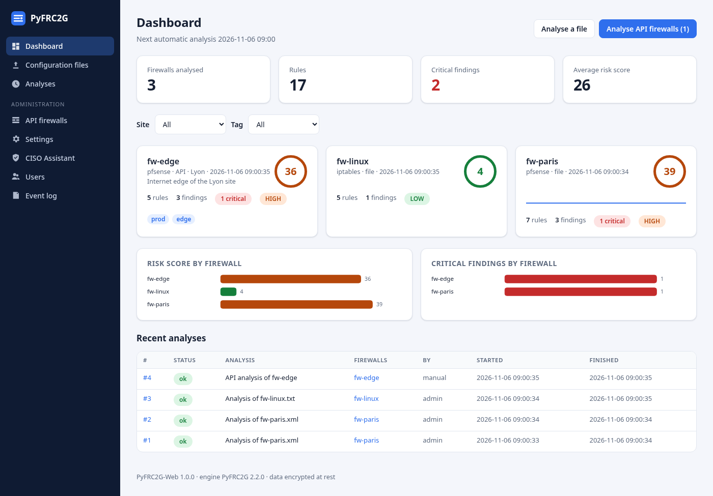
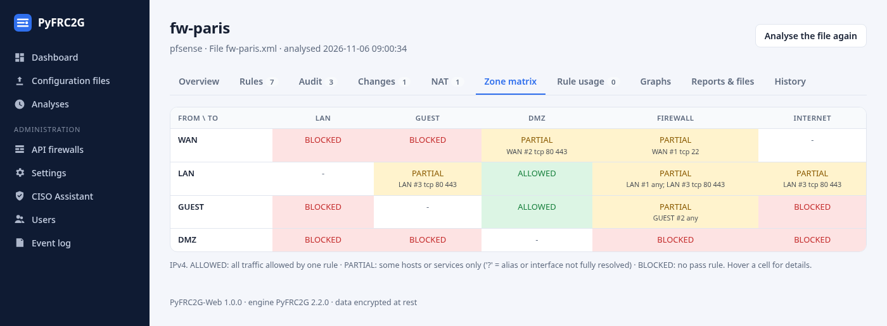
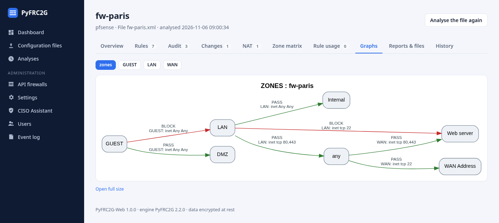
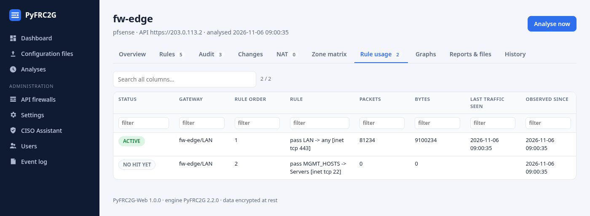
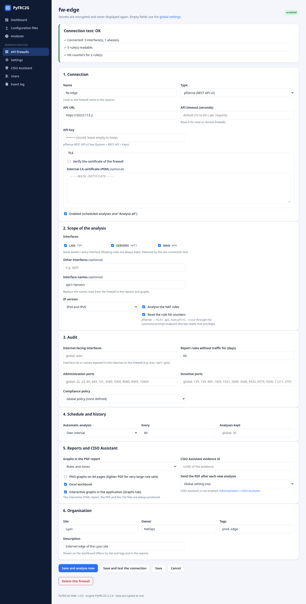

# PyFRC2G-Web

Web application of [PyFRC2G](../README.md): follow the firewall rules of pfSense, OPNsense,
FortiGate, iptables, nftables, nfSensei and Stormshield from the browser, with dashboards, charts,
Graphviz graphs, audit and compliance reports, and all the data stored **encrypted** in an
SQLite database.

The engine in [`../engine`](../engine/) (package `pyfrc2g`) does the analyses; this folder
(package `pyfrc2g-web`) adds the web interface. Command line users only need the engine.



## 🐳 Docker (recommended)

The image only contains Python, Graphviz and the dependencies (`requirements.txt`): the code
(`web/pyfrc2g_web` and `engine/pyfrc2g`) is mounted as read-only volumes from the cloned
repository. The image stays small, and updating does not need a rebuild.

```bash
git clone https://github.com/olivierb46/PyFRC2G.git
cd PyFRC2G/web
cp .env.example .env                 # works as is: sign in as admin, then change the password
docker compose up -d --build         # http://localhost:8080
```

Update to a new version:

```bash
git pull                             # or git checkout <tag>
docker compose restart
```

Rebuild the image (`docker compose up -d --build`) only when `requirements.txt` changes.

| Volume | Container path | Content |
|--------|----------------|---------|
| `./pyfrc2g_web` | `/app/pyfrc2g-web/pyfrc2g_web` (read-only) | web application code |
| `../engine/pyfrc2g` | `/app/pyfrc2g/pyfrc2g` (read-only) | engine code |
| `pyfrc2g-data` | `/data` | encrypted database |

The container runs as an unprivileged user (uid 10001), stops cleanly on `docker stop` and has
a health check on `/health`. The volumes use `,z` for SELinux hosts (Fedora, RHEL); it is
ignored elsewhere. Create the first administrator with `PYFRC2G_ADMIN_USER` /
`PYFRC2G_ADMIN_PASSWORD`, or
`docker compose exec pyfrc2g-web python -m pyfrc2g_web --create-admin admin`.

## 💾 Installation without Docker

Graphviz must be installed on the system (`apt install graphviz`, `dnf install graphviz`,
`brew install graphviz`). From the root of the repository, one command installs the engine and
the web application:

```bash
pip install ./engine ./web              # development: pip install -e ./engine -e ./web

export PYFRC2G_SECRET_KEY="a long passphrase or a Fernet key"
pyfrc2g-web --create-admin admin        # first administrator (password prompted)
pyfrc2g-web                             # http://127.0.0.1:8080
```

Without cloning (git required):

```bash
pip install "pyfrc2g @ git+https://github.com/olivierb46/PyFRC2G.git@v2.3.0#subdirectory=engine" \
            "pyfrc2g-web @ git+https://github.com/olivierb46/PyFRC2G.git@v2.3.0#subdirectory=web"
```

The engine is not published on PyPI: always install it with the web application as shown
above (`pyfrc2g-web` declares `pyfrc2g>=2.3.0`).

## ✨ Features

| Firewall overview | Zone matrix |
|:---:|:---:|
| [](../img/web-firewall-overview.png) | [](../img/web-zone-matrix.png) |
| **Graphs** | **Rule usage (hit counters)** |
| [](../img/web-graphs.png) | [](../img/web-rule-usage.png) |

- **Dashboard**: risk score of each firewall with its trend, number of rules and findings, critical findings, comparison charts, latest analyses
- **Firewall page**: overview (risk score over time, findings by severity, actions, rules and risk per interface, most severe findings), filterable tables of rules, audit findings, changes, NAT and rule usage, zone matrix, Graphviz graphs displayed in the page (zones view and one graph per interface), PDF / HTML / Excel / CSV reports, history of the stored analyses
- **Configuration files**: upload a backup in any supported format (`.zip` / `.tar.gz` for Stormshield); name, site and CISO Assistant ids can be given with the upload; once analysed, the firewall has its own **Settings** page (IP version, NAT, audit ports and WAN interfaces, compliance policy, reports, retention, CISO Assistant evidence / folder, site, owner, tags) applied to every new analysis of that file; the analysis log is shown live
- **Parallel reading**: when a run analyses several API firewalls (“Analyse all”, scheduled analyses), up to *API firewalls read in parallel* of them (Administration > Settings, default 4) are read at the same time; the log lines are prefixed with the firewall name. Analyses and reports stay one after the other
- **API firewalls** (admin): pfSense / OPNsense / nfSensei (API key) with their credentials, TLS verification and internal CA; connection test; "analyse now" and automatic analysis on a schedule; per-firewall options (see below)
- **Settings** (admin): schedule, number of analyses kept, audit parameters (WAN interfaces, administration / sensitive ports, unused days) and the compliance policy edited and validated in the page
- **Compare**: two firewalls or two analyses of the same firewall (rules, NAT rules, findings)
- **Accepted risks** (admin; operators propose, an administrator approves, see below): accept a finding from the Audit tab with a justification, owner and optional expiry date, for one rule or a whole check, on one firewall or all of them; it leaves the findings and the risk score (until it expires), and stays listed with its reason (Administration > Accepted risks). The engine receives the accepted risks too: the PDF, HTML and Excel reports and the risk score leave them out and list them in an “Accepted risks” section with their justification; adding or removing an exception regenerates the reports of the affected firewalls (API firewalls are read again, files analysed again)
- **Policies by site / tag** (admin): compliance policies added to the global one for the firewalls of a site or carrying a tag (Administration > Policies)
- **Export** of the dashboard (same site / tag filters) as an Excel workbook (summary, findings, accepted risks, changes) or a PDF summary for reviews
- **CISO Assistant** (admin): send the PDF report of an analysis as a new revision of an evidence, manually from the firewall page or automatically after each new analysis; default evidence plus one evidence per firewall, connection test, history of the uploads
- **How it works**: the page rendered from [`HOW_IT_WORKS.md`](../HOW_IT_WORKS.md) (analysis steps, findings, risk score, accepted risks, reports, CISO Assistant). The application serves its copy `pyfrc2g_web/docs/how-it-works.md`: after editing the file at the repository root, run `cp HOW_IT_WORKS.md web/pyfrc2g_web/docs/how-it-works.md`
- **Users** (admin): `admin`, `operator`, `auditor` and `viewer` roles, optional firewall scope per user or per SSO group; **sessions** (list, revoke, limit); **event log** of sign-ins, changes, uploads and analyses, exportable (CSV / JSON, SIEM)
- **Notifications** (admin): alerts (email, webhook, Slack, Teams) on new critical findings or risk drift, scheduled PDF / Excel reports by email
- **Trends**: risk score, findings, permissive rules and rule count over time, per firewall
- **Backup & keys** (admin): encrypted backup download, key rotation (see below)

### Firewall options

Each API firewall (Administration > API firewalls) has its own settings; an empty field uses
the global one (Administration > Settings).

<details><summary>Screenshot of the firewall settings (connection test and the 6 blocks)</summary>



</details>

| Block | Options |
|-------|---------|
| 1. Connection | URL, credentials, TLS / internal CA, API timeout; **Save and test the connection** checks the credentials and TLS, lists the interfaces, the readable rules and the hit counters |
| 2. Scope | interfaces to analyse (ticked from the list found by the connection test), interface names (`opt1=DMZ`), IPv4 / IPv6, NAT rules, hit counters (pfSense: `--hits api`, runs `pfctl -vvsr` through the command prompt endpoint), OPNsense rules generated by the firewall (global setting, included, or hidden as in a backup file) |
| 3. Audit | Internet-facing interfaces, administration / sensitive ports, days before a rule is reported unused, compliance policy (global, own policy or none) |
| 4. Schedule | global schedule, own interval or manual only; number of analyses kept |
| 5. Reports | graphs of the PDF (rules, zones or both), PNG graphs on A4 pages, Excel workbook, graphs in the application; CISO Assistant evidence id and automatic upload (global, yes, no) |
| 6. Organisation | site, owner, tags, description: shown on the dashboard (filters by site and tag), in the firewall list and in the reports |

### CISO Assistant

Administration > CISO Assistant: URL, API token (personal access token, stored encrypted and
never displayed again), folder id, default evidence id, TLS verification or internal CA, and
the comment of the revisions (variables `{gateway}`, `{date}`, `{score}`, `{level}`).
"Save and test the connection" checks the token, the folder and the default evidence.

Each upload sends the PDF report of the analysis to `POST /api/evidence-revisions/` (same API
as the engine's `CISO_*` settings): manually with "Send to CISO Assistant" on the firewall page,
or automatically after each new analysis when the option is enabled. A firewall can have its
own evidence id and folder (domain) id (or a folder per site, Administration > CISO Assistant: firewall folder, then site folder, then default folder), optionally the change report (CSV) as a second evidence (firewall page, tab Overview, or the firewall settings), for a proof
belonging to another site; otherwise the default ones are used.
Results are listed on the CISO Assistant page, on the firewall page and in the event log.
In the web application the engine never uploads by itself, even if `PYFRC2G_CISO_*`
variables are set.

### Encryption

Firewall credentials, CA certificates, settings, compliance policy, uploaded files, analysed
rules and findings, generated reports and graphs, and analysis logs are encrypted with
Fernet (AES-128-CBC + HMAC-SHA256, `cryptography` library) before being written to
`<data dir>/pyfrc2g.db`. Names, dates and risk scores stay readable for listing and sorting.
Analyses run in a private temporary directory that is deleted at the end: no report stays in
clear on disk.

- `PYFRC2G_SECRET_KEY`: Fernet key (`python -c "from cryptography.fernet import Fernet; print(Fernet.generate_key().decode())"`) or any passphrase (derived with scrypt). Without it, a key is generated in `<data dir>/secret.key`: convenient for a test, but the key then sits next to the database.
- Key rotation: set the new key in `PYFRC2G_SECRET_KEY` and the previous one in `PYFRC2G_SECRET_KEY_OLD`.
- A wrong key is detected at start-up (the application refuses to start). **Keep a copy of the key: without it the data cannot be recovered.**

### Settings

| Setting | Variable / option | Default |
|---------|-------------------|---------|
| Encryption key | `PYFRC2G_SECRET_KEY` (`PYFRC2G_SECRET_KEY_OLD` for rotation) | generated in `<data dir>/secret.key` |
| First administrator | `pyfrc2g-web --create-admin NAME`, or `PYFRC2G_ADMIN_USER` / `PYFRC2G_ADMIN_PASSWORD` (empty database only) | none |
| Address / port | `--host` / `--port`, `PYFRC2G_WEB_HOST` / `PYFRC2G_WEB_PORT` | `127.0.0.1` / `8080` (`0.0.0.0` in Docker) |
| Data directory | `--data-dir`, `PYFRC2G_DATA_DIR` | `pyfrc2g-data` (`/data` in Docker) |
| Schedule | Settings page (default interval; each firewall can have its own or be manual only), or `--every` / `PYFRC2G_SCHEDULE` at start-up | none |
| Upload limit | `PYFRC2G_WEB_MAX_UPLOAD_MB` | 50 (a full nfSensei backup `.tar.gz` can be several hundred MB: only its `running.yaml` is kept) |
| Behind a reverse proxy | `PYFRC2G_WEB_PROXY=1` (trust `X-Forwarded-*`), `PYFRC2G_WEB_SECURE_COOKIES=1` (HTTPS only cookies) | off |

### Single sign-on (OpenID Connect)

Optional: `pip install "pyfrc2g-web[oidc]"` (flask-oidc + Flask-Session, already in `requirements.txt` /
the Docker image), then set `PYFRC2G_OIDC_ISSUER`, `PYFRC2G_OIDC_CLIENT_ID` and
`PYFRC2G_OIDC_CLIENT_SECRET` (see `.env.example`). Declare this redirect URI at the identity
provider: `https://<your-host>/oidc/authorize`. The login page then shows a "Sign in with SSO" button.

- Users are created at first sign-in, without a local password. Their role is recomputed at each
  sign-in: members of `PYFRC2G_OIDC_ADMIN_GROUPS` (claim `PYFRC2G_OIDC_GROUPS_CLAIM`, default
  `groups`) are administrators, the others get `PYFRC2G_OIDC_DEFAULT_ROLE` (default `viewer`);
  `PYFRC2G_OIDC_ALLOWED_GROUPS` restricts who may sign in at all.
- An SSO user whose name equals a local account is refused (no takeover of a local administrator).
- Sessions become server-side (files in `<data dir>/sessions`, mode 0700; the cookie holds only a
  random identifier, renewed at sign-in). Sign-out ends the application session, not the one at the
  identity provider. Local accounts keep working as a break-glass access.

### Roles, firewall scopes and sessions

| Role | Can |
|---|---|
| `admin` | everything: configuration, firewalls, users, sessions, backups, approval of accepted risks |
| `operator` | run analyses (API firewalls, re-analysis), upload files, *propose* accepted risks |
| `auditor` | read everything, export reports, read the event log and the accepted risks (read only) |
| `viewer` | read dashboards, reports and graphs, export them |

With SSO, groups map to roles: `PYFRC2G_OIDC_ADMIN_GROUPS`, `..._OPERATOR_GROUPS`, `..._AUDITOR_GROUPS`,
`..._VIEWER_GROUPS` (the most privileged matching role wins). Existing `viewer` / `admin` accounts keep
their role (the users table is migrated automatically at start-up).

**Firewall scope.** A non-administrator can be limited to some firewalls, by name, site or tag
(Administration > Users: `site: Paris, Lyon; tag: prod; fw: fw-edge1`). For SSO users, a mapping
`idp-group = site:Paris, tag:acme` (same page) is evaluated at each sign-in; once a rule exists, an SSO
user matching none of the groups sees no firewall. A scoped user only sees their firewalls on the
dashboard, exports, comparison, analyses and trends; the others answer 404. A scoped operator cannot
upload files (they could create a firewall outside the scope) nor accept a risk on "all firewalls".

**Sessions.** *Administration > Sessions* lists the signed-in browsers (user, address, browser, last
activity) and revokes one session or all the sessions of a user; a deleted user or a changed password also
ends their sessions. `PYFRC2G_MAX_SESSIONS=N` limits the simultaneous sessions per user (the oldest is
revoked). Works with and without SSO.

**Accepted risks.** An administrator's acceptance applies at once; an operator's is a *proposal* that
an administrator approves or rejects (*Administration > Accepted risks*, who proposed and who decided are
kept). Pending and rejected proposals are never applied. `PYFRC2G_RISK_FOUR_EYES=1`: every acceptance,
administrators' included, must be approved by *another* administrator. Once a day an `accepted risk
expiring` event is emitted `PYFRC2G_RISK_REMINDER_DAYS` days (default 14) before each expiry; it appears in
the event log and reaches the SIEM / webhook below. The page also shows the days left.

**Trends.** *Trends* charts, for each firewall, the risk score, the findings, the overly permissive rules
(any → any checks), the critical + high findings and the number of rules over the stored analyses (last
10 to 120). The figures are kept in clear columns: older analyses are filled in at the first start-up.

### Audit export (SIEM)

Every event of the log (sign-in, failed sign-in, role / scope change, deletion, accepted risk, backup...)
can also be sent as JSON, one object per event: `{"app", "host", "time", "username", "action", "detail"}`.

| Variable | Meaning |
|---|---|
| `PYFRC2G_AUDIT_SYSLOG` | `udp://host:514`, `tcp://host:514` or `unix:///dev/log` |
| `PYFRC2G_AUDIT_WEBHOOK` | `https://collector/events`: JSON `POST`, 3 attempts, bounded queue, no redirect |
| `PYFRC2G_AUDIT_WEBHOOK_SECRET` | optional: `X-PyFRC2G-Signature: sha256=<HMAC of the body>` |
| `PYFRC2G_AUDIT_WEBHOOK_TOKEN` | optional: `Authorization: Bearer ...` |

An unreachable collector never blocks the application. The log can also be downloaded
(*Event log > CSV / JSON lines*, spreadsheet formulas neutralised).

### Backup and key rotation

*Administration > Backup & keys*: download a consistent snapshot of the database encrypted with a
passphrase you choose (scrypt + Fernet; not stored). Restore with the application stopped:
`pyfrc2g-web --restore-backup FILE --data-dir DIR [--force]`; you need the passphrase **and**
`PYFRC2G_SECRET_KEY` (the content is encrypted with it too).

Key rotation: new key in `PYFRC2G_SECRET_KEY`, previous one in `PYFRC2G_SECRET_KEY_OLD`, restart, click
*Re-encrypt* on that page (it shows how many values still use an old key), then remove the old key.

### Notifications and scheduled reports

*Administration > Notifications* (administrators). Mail server in the environment (`PYFRC2G_SMTP_HOST`,
`_PORT`, `_SECURITY`, `_USER`, `_PASSWORD`, `_FROM`, see `.env.example`); channels and schedules in the page.

**Alerts.** After each analysis, the new findings and the rise of the risk score compared with the
previous analysis of the firewall are sent to the channels that subscribed: email, JSON webhook (optional
HMAC signature `X-PyFRC2G-Signature`), Slack, Microsoft Teams. Events: new critical finding, new high
finding, risk score rise (threshold in points, default 10), new permissive rule (any), analysis failed. A
finding is announced once; the first analysis of a firewall is the baseline and sends nothing. A channel
can be limited to some firewalls (`site: Paris; tag: prod; fw: fw1`) and sends either *minimal* content
(firewall, score, counts) or the *detailed* new findings. *Test* sends a harmless message.

**Scheduled reports.** The PDF or Excel export of the dashboard, optionally filtered by site or tag, is
e-mailed every day, week or month (hour of the server) to a list of recipients; *Send now* triggers one. After
a stop of the application the missed report is sent once at restart.

**Security.** Mail uses STARTTLS or TLS with certificate verification (`none` only for a server on the
machine itself); recipients are validated (no header injection) and can be restricted with
`PYFRC2G_MAIL_ALLOWED_DOMAINS` so that a compromised admin account cannot send reports elsewhere. Webhook
URLs must be `https://`; Slack and Teams URLs must belong to the vendors' domains
(`PYFRC2G_NOTIFY_WEBHOOK_HOSTS` adds some); a generic webhook may not resolve to a private, loopback or
link-local address (checked when it is saved and at each delivery; `PYFRC2G_NOTIFY_ALLOW_PRIVATE=1` lifts
it for an internal collector); redirects are not followed. URLs, secrets and recipients are encrypted in the
database, never shown again, and included in the backup and the key rotation. Messages are sent in the
background (3 attempts) so a collector that is down never slows an analysis; every success or failure is in
the event log (class of the error only, never the URL).

### Tests

`pip install -e "./web[dev]"` then `pytest web/tests` (roles, scopes, sessions, shared throttle, audit
export, backup, key rotation, trends, accepted-risk workflow, SSO flow with a fake identity provider).

**Redis session store (optional).** By default sessions are files in `<data dir>/sessions`. For several
instances, or to keep sessions out of the data volume, use Redis. With Docker, in `.env`:

```
COMPOSE_PROFILES=redis
PYFRC2G_REDIS_URL=redis://pyfrc2g@redis:6379/0
PYFRC2G_REDIS_PASSWORD=<openssl rand -base64 36 | tr -d '/+='>
```

The `redis` service of `docker-compose.yml` is hardened: internal network without outside route and no
published port, `default` user disabled, one ACL user limited to `session:*` keys without admin or
dangerous commands, nothing persisted to disk, read-only filesystem, no capabilities, memory limit.
The application refuses a Redis without password, checks it at start-up (fails fast) and never logs the
URL. For an external Redis use `rediss://` (TLS, certificate verified, `PYFRC2G_REDIS_CA` for a private CA).
When `PYFRC2G_REDIS_URL` is set, the sign-in throttle (5 failures / 10 minutes) is also shared through Redis
(hashed keys `throttle:*`), so it holds with several instances; it falls back to memory if Redis fails.
Redis is used with or without SSO.

### Security

Passwords hashed (Werkzeug scrypt / PBKDF2), 10 characters minimum; sign-in locked for
10 minutes after 5 failures (per address and per user); sessions signed with a key derived
from the encryption key, invalidated when the password changes; CSRF token on every form;
strict Content Security Policy (no inline script, no external resource), generated reports and
SVG graphs served in a sandbox; secrets never sent back to the browser; uploaded archives
extracted without leaving their directory. The application is served by waitress over plain
HTTP: put a TLS reverse proxy (nginx, Traefik, Caddy...) in front of it when it is reachable
from other machines.


## 🔗 Compatibility

| PyFRC2G-Web (`web/`) | PyFRC2G engine (`engine/`) |
|----------------------|----------------------------|
| 1.1.x | 2.3.0 or later |
| 1.0.x | 2.2.0 or later |

The application checks the engine version at start-up.

## 📄 License

MIT, see [LICENSE](../LICENSE).
