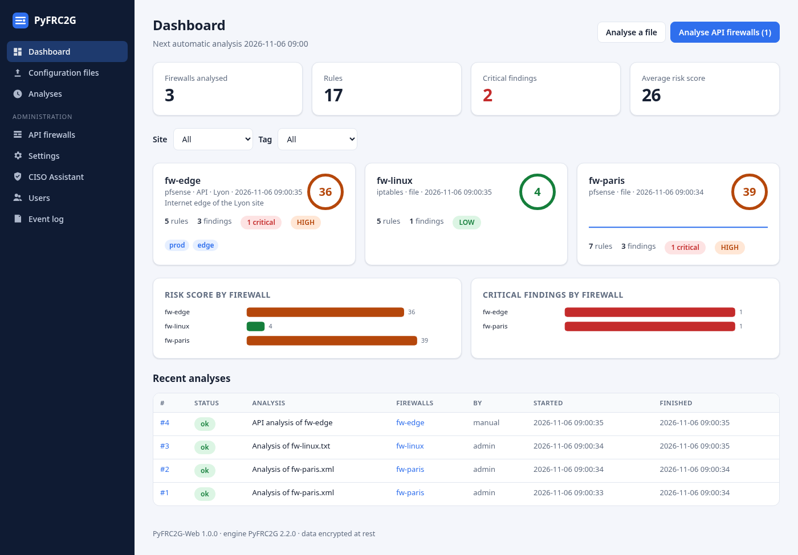
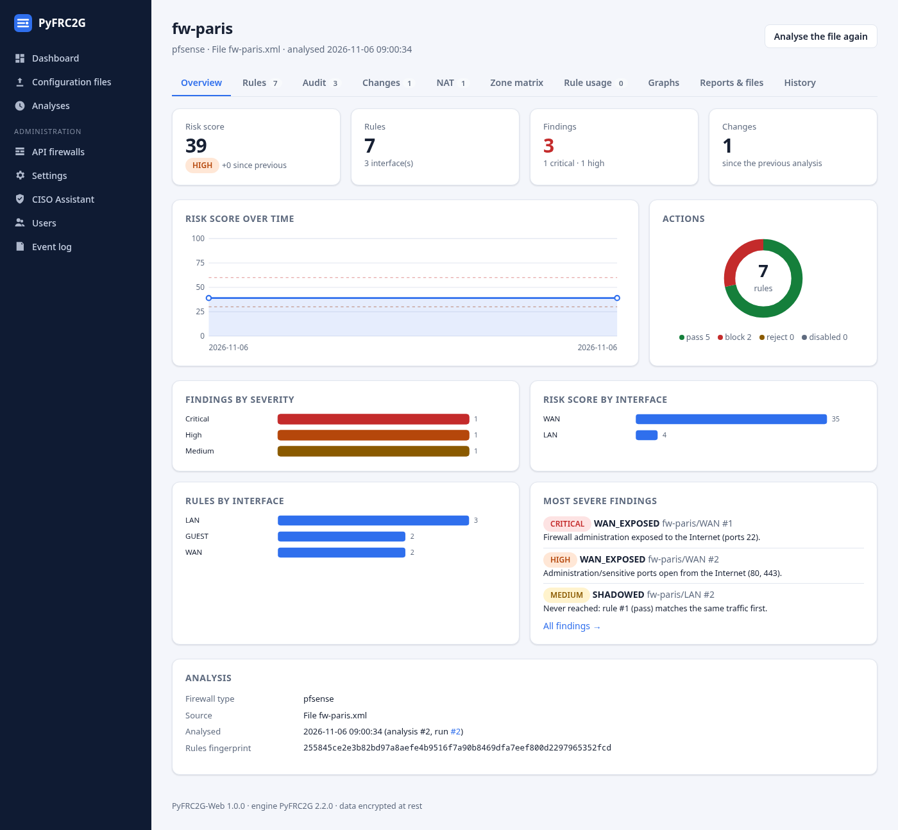
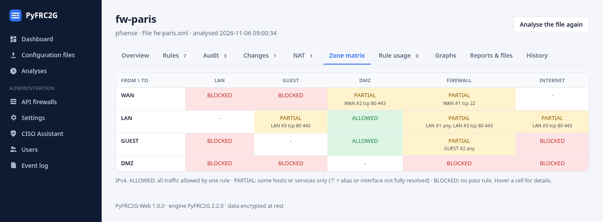
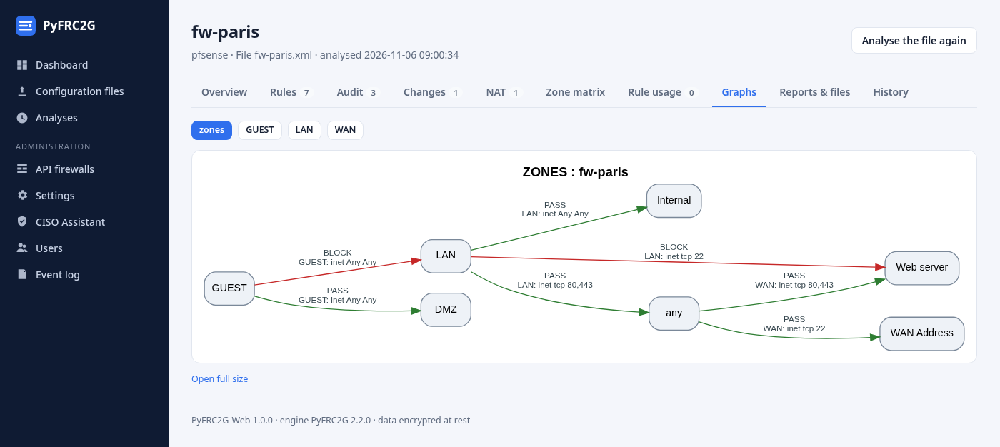
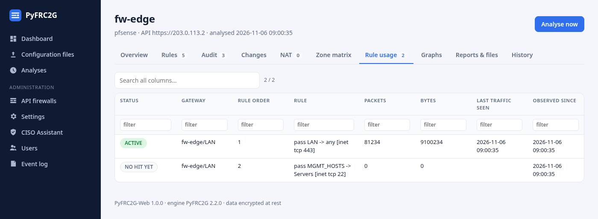
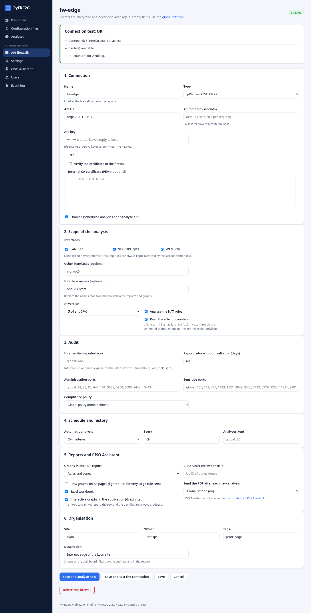

# PyFRC2G-Web

Web application of [PyFRC2G](../README.md): follow the firewall rules of pfSense, OPNsense,
FortiGate, iptables, nftables, nfSensei and Stormshield from the browser, with dashboards, charts,
Graphviz graphs, audit and compliance reports, and all the data stored **encrypted** in an
SQLite database.

The engine in [`../engine`](../engine/) (package `pyfrc2g`) does the analyses; this folder
(package `pyfrc2g-web`) adds the web interface. Command line users only need the engine.



## 🐳 Docker (recommended)

The image only contains Python, Graphviz and the dependencies (`requirements.txt`): the code
(`web/pyfrc2g_web` and `engine/pyfrc2g`) is mounted as read-only volumes from the cloned
repository. The image stays small, and updating does not need a rebuild.

```bash
git clone https://github.com/olivierb46/PyFRC2G.git
cd PyFRC2G/web
cp .env.example .env                 # PYFRC2G_SECRET_KEY, PYFRC2G_ADMIN_USER / PYFRC2G_ADMIN_PASSWORD
docker compose up -d --build         # http://localhost:8080
```

Update to a new version:

```bash
git pull                             # or git checkout <tag>
docker compose restart
```

Rebuild the image (`docker compose up -d --build`) only when `requirements.txt` changes.

| Volume | Container path | Content |
|--------|----------------|---------|
| `./pyfrc2g_web` | `/app/pyfrc2g-web/pyfrc2g_web` (read-only) | web application code |
| `../engine/pyfrc2g` | `/app/pyfrc2g/pyfrc2g` (read-only) | engine code |
| `pyfrc2g-data` | `/data` | encrypted database |

The container runs as an unprivileged user (uid 10001), stops cleanly on `docker stop` and has
a health check on `/health`. The volumes use `,z` for SELinux hosts (Fedora, RHEL); it is
ignored elsewhere. Create the first administrator with `PYFRC2G_ADMIN_USER` /
`PYFRC2G_ADMIN_PASSWORD`, or
`docker compose exec pyfrc2g-web python -m pyfrc2g_web --create-admin admin`.

## 💾 Installation without Docker

Graphviz must be installed on the system (`apt install graphviz`, `dnf install graphviz`,
`brew install graphviz`). From the root of the repository, one command installs the engine and
the web application:

```bash
pip install ./engine ./web              # development: pip install -e ./engine -e ./web

export PYFRC2G_SECRET_KEY="a long passphrase or a Fernet key"
pyfrc2g-web --create-admin admin        # first administrator (password prompted)
pyfrc2g-web                             # http://127.0.0.1:8080
```

Without cloning (git required):

```bash
pip install "pyfrc2g @ git+https://github.com/olivierb46/PyFRC2G.git@v2.3.0#subdirectory=engine" \
            "pyfrc2g-web @ git+https://github.com/olivierb46/PyFRC2G.git@v2.3.0#subdirectory=web"
```

The engine is not published on PyPI: always install it with the web application as shown
above (`pyfrc2g-web` declares `pyfrc2g>=2.3.0`).

## ✨ Features

| Firewall overview | Zone matrix |
|:---:|:---:|
| [](../img/web-firewall-overview.png) | [](../img/web-zone-matrix.png) |
| **Graphs** | **Rule usage (hit counters)** |
| [](../img/web-graphs.png) | [](../img/web-rule-usage.png) |

- **Dashboard**: risk score of each firewall with its trend, number of rules and findings, critical findings, comparison charts, latest analyses
- **Firewall page**: overview (risk score over time, findings by severity, actions, rules and risk per interface, most severe findings), filterable tables of rules, audit findings, changes, NAT and rule usage, zone matrix, Graphviz graphs displayed in the page (zones view and one graph per interface), PDF / HTML / Excel / CSV reports, history of the stored analyses
- **Configuration files**: upload a backup in any supported format (`.zip` / `.tar.gz` for Stormshield); name, site and CISO Assistant ids can be given with the upload; once analysed, the firewall has its own **Settings** page (IP version, NAT, audit ports and WAN interfaces, compliance policy, reports, retention, CISO Assistant evidence / folder, site, owner, tags) applied to every new analysis of that file; the analysis log is shown live
- **Parallel reading**: when a run analyses several API firewalls (“Analyse all”, scheduled analyses), up to *API firewalls read in parallel* of them (Administration > Settings, default 4) are read at the same time; the log lines are prefixed with the firewall name. Analyses and reports stay one after the other
- **API firewalls** (admin): pfSense / OPNsense / nfSensei (API key) with their credentials, TLS verification and internal CA; connection test; "analyse now" and automatic analysis on a schedule; per-firewall options (see below)
- **Settings** (admin): schedule, number of analyses kept, audit parameters (WAN interfaces, administration / sensitive ports, unused days) and the compliance policy edited and validated in the page
- **Compare**: two firewalls or two analyses of the same firewall (rules, NAT rules, findings)
- **Accepted risks** (admin): accept a finding from the Audit tab with a justification, owner and optional expiry date, for one rule or a whole check, on one firewall or all of them; it leaves the findings and the risk score (until it expires), and stays listed with its reason (Administration > Accepted risks). The engine receives the accepted risks too: the PDF, HTML and Excel reports and the risk score leave them out and list them in an “Accepted risks” section with their justification; adding or removing an exception regenerates the reports of the affected firewalls (API firewalls are read again, files analysed again)
- **Policies by site / tag** (admin): compliance policies added to the global one for the firewalls of a site or carrying a tag (Administration > Policies)
- **Export** of the dashboard (same site / tag filters) as an Excel workbook (summary, findings, accepted risks, changes) or a PDF summary for reviews
- **CISO Assistant** (admin): send the PDF report of an analysis as a new revision of an evidence, manually from the firewall page or automatically after each new analysis; default evidence plus one evidence per firewall, connection test, history of the uploads
- **How it works**: the page rendered from [`HOW_IT_WORKS.md`](../HOW_IT_WORKS.md) (analysis steps, findings, risk score, accepted risks, reports, CISO Assistant). The application serves its copy `pyfrc2g_web/docs/how-it-works.md`: after editing the file at the repository root, run `cp HOW_IT_WORKS.md web/pyfrc2g_web/docs/how-it-works.md`
- **Users** (admin): `admin` (configuration, analyses, users) and `viewer` (reports, graphs) roles; **event log** of sign-ins, changes, uploads and manual analyses

### Firewall options

Each API firewall (Administration > API firewalls) has its own settings; an empty field uses
the global one (Administration > Settings).

<details><summary>Screenshot of the firewall settings (connection test and the 6 blocks)</summary>



</details>

| Block | Options |
|-------|---------|
| 1. Connection | URL, credentials, TLS / internal CA, API timeout; **Save and test the connection** checks the credentials and TLS, lists the interfaces, the readable rules and the hit counters |
| 2. Scope | interfaces to analyse (ticked from the list found by the connection test), interface names (`opt1=DMZ`), IPv4 / IPv6, NAT rules, hit counters (pfSense: `--hits api`, runs `pfctl -vvsr` through the command prompt endpoint), OPNsense rules generated by the firewall (global setting, included, or hidden as in a backup file) |
| 3. Audit | Internet-facing interfaces, administration / sensitive ports, days before a rule is reported unused, compliance policy (global, own policy or none) |
| 4. Schedule | global schedule, own interval or manual only; number of analyses kept |
| 5. Reports | graphs of the PDF (rules, zones or both), PNG graphs on A4 pages, Excel workbook, graphs in the application; CISO Assistant evidence id and automatic upload (global, yes, no) |
| 6. Organisation | site, owner, tags, description: shown on the dashboard (filters by site and tag), in the firewall list and in the reports |

### CISO Assistant

Administration > CISO Assistant: URL, API token (personal access token, stored encrypted and
never displayed again), folder id, default evidence id, TLS verification or internal CA, and
the comment of the revisions (variables `{gateway}`, `{date}`, `{score}`, `{level}`).
"Save and test the connection" checks the token, the folder and the default evidence.

Each upload sends the PDF report of the analysis to `POST /api/evidence-revisions/` (same API
as the engine's `CISO_*` settings): manually with "Send to CISO Assistant" on the firewall page,
or automatically after each new analysis when the option is enabled. A firewall can have its
own evidence id and folder (domain) id (or a folder per site, Administration > CISO Assistant: firewall folder, then site folder, then default folder), optionally the change report (CSV) as a second evidence (firewall page, tab Overview, or the firewall settings), for a proof
belonging to another site; otherwise the default ones are used.
Results are listed on the CISO Assistant page, on the firewall page and in the event log.
In the web application the engine never uploads by itself, even if `PYFRC2G_CISO_*`
variables are set.

### Encryption

Firewall credentials, CA certificates, settings, compliance policy, uploaded files, analysed
rules and findings, generated reports and graphs, and analysis logs are encrypted with
Fernet (AES-128-CBC + HMAC-SHA256, `cryptography` library) before being written to
`<data dir>/pyfrc2g.db`. Names, dates and risk scores stay readable for listing and sorting.
Analyses run in a private temporary directory that is deleted at the end: no report stays in
clear on disk.

- `PYFRC2G_SECRET_KEY`: Fernet key (`python -c "from cryptography.fernet import Fernet; print(Fernet.generate_key().decode())"`) or any passphrase (derived with scrypt). Without it, a key is generated in `<data dir>/secret.key`: convenient for a test, but the key then sits next to the database.
- Key rotation: set the new key in `PYFRC2G_SECRET_KEY` and the previous one in `PYFRC2G_SECRET_KEY_OLD`.
- A wrong key is detected at start-up (the application refuses to start). **Keep a copy of the key: without it the data cannot be recovered.**

### Settings

| Setting | Variable / option | Default |
|---------|-------------------|---------|
| Encryption key | `PYFRC2G_SECRET_KEY` (`PYFRC2G_SECRET_KEY_OLD` for rotation) | generated in `<data dir>/secret.key` |
| First administrator | `pyfrc2g-web --create-admin NAME`, or `PYFRC2G_ADMIN_USER` / `PYFRC2G_ADMIN_PASSWORD` (empty database only) | none |
| Address / port | `--host` / `--port`, `PYFRC2G_WEB_HOST` / `PYFRC2G_WEB_PORT` | `127.0.0.1` / `8080` (`0.0.0.0` in Docker) |
| Data directory | `--data-dir`, `PYFRC2G_DATA_DIR` | `pyfrc2g-data` (`/data` in Docker) |
| Schedule | Settings page (default interval; each firewall can have its own or be manual only), or `--every` / `PYFRC2G_SCHEDULE` at start-up | none |
| Upload limit | `PYFRC2G_WEB_MAX_UPLOAD_MB` | 50 (a full nfSensei backup `.tar.gz` can be several hundred MB: only its `running.yaml` is kept) |
| Behind a reverse proxy | `PYFRC2G_WEB_PROXY=1` (trust `X-Forwarded-*`), `PYFRC2G_WEB_SECURE_COOKIES=1` (HTTPS only cookies) | off |

### Security

Passwords hashed (Werkzeug scrypt / PBKDF2), 10 characters minimum; sign-in locked for
10 minutes after 5 failures (per address and per user); sessions signed with a key derived
from the encryption key, invalidated when the password changes; CSRF token on every form;
strict Content Security Policy (no inline script, no external resource), generated reports and
SVG graphs served in a sandbox; secrets never sent back to the browser; uploaded archives
extracted without leaving their directory. The application is served by waitress over plain
HTTP: put a TLS reverse proxy (nginx, Traefik, Caddy...) in front of it when it is reachable
from other machines.


## 🔗 Compatibility

| PyFRC2G-Web (`web/`) | PyFRC2G engine (`engine/`) |
|----------------------|----------------------------|
| 1.1.x | 2.3.0 or later |
| 1.0.x | 2.2.0 or later |

The application checks the engine version at start-up.

## 📄 License

MIT, see [LICENSE](../LICENSE).
