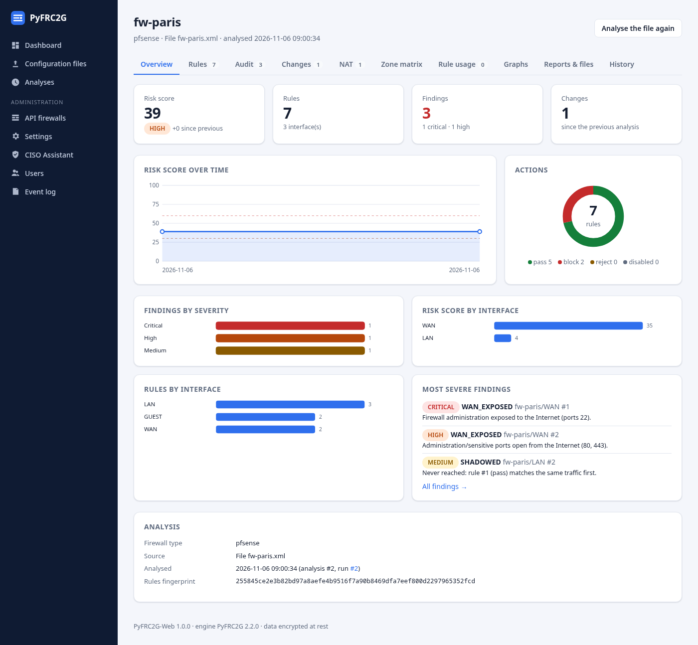

# PyFRC2G-Web

Web application of [PyFRC2G](../README.md): follow the firewall rules of pfSense, OPNsense,
FortiGate, iptables, nftables, nfSensei and Stormshield from the browser, with dashboards, charts,
Graphviz graphs, audit and compliance reports, and all the data stored **encrypted** in an
SQLite database.

The engine in [`../engine`](../engine/) (package `pyfrc2g`) does the analyses; this folder
(package `pyfrc2g-web`) adds the web interface. Command line users only need the engine.


## 🐳 Docker (recommended)

The image only contains Python, Graphviz and the dependencies (`requirements.txt`): the code
(`web/pyfrc2g_web` and `engine/pyfrc2g`) is mounted as read-only volumes from the cloned
repository. The image stays small, and updating does not need a rebuild.

The web application runs with Docker (Compose). Three services start together: **nginx** (the only way in, HTTPS),
the **application** and **Redis** (sign-in counters, sessions with SSO).

**Prerequisites**

1. Docker with the Compose plugin, and ports 80 and 443 free on the host (or `PYFRC2G_HTTP_PORT` /
   `PYFRC2G_HTTPS_PORT` in `.env`; a rootless podman cannot bind below 1024).
2. A **TLS certificate** for the name of the site: `nginx/certs/fullchain.pem` (certificate and chain) and
   `nginx/certs/privkey.pem` (private key, no passphrase), readable by everybody on the host (`chmod 644`, the folder is
   ignored by git). From your CA or Let's Encrypt; for a test, a self-signed one (the browser warns):

   ```bash
   openssl req -x509 -newkey ec -pkeyopt ec_paramgen_curve:prime256v1 -nodes -days 365 -subj "/CN=localhost" \
       -addext "subjectAltName=DNS:localhost" -keyout nginx/certs/privkey.pem -out nginx/certs/fullchain.pem
   chmod 644 nginx/certs/*.pem
   ```
   (use your own name instead of `localhost`, and the same one in `PYFRC2G_SERVER_NAME`).
3. A **password for Redis** in `.env` (`docker compose` refuses to start without it): `PYFRC2G_REDIS_PASSWORD`, for
   example `openssl rand -base64 36 | tr -d '/+='`.

```bash
git clone https://github.com/olivierb46/PyFRC2G.git
cd PyFRC2G/web
cp .env.example .env                 # then set PYFRC2G_REDIS_PASSWORD (and PYFRC2G_SERVER_NAME) in it
# put the certificate in nginx/certs/ (prerequisite 2)
docker compose up -d --build         # https://localhost/ : sign in as admin, then change the password
```

After renewing the certificate: `docker compose restart nginx`. See *HTTPS reverse proxy* and *Redis* below.

Update to a new version:

```bash
git pull                             # or git checkout <tag>
docker compose restart
```

Rebuild the image (`docker compose up -d --build`) only when `requirements.txt` changes.

| Volume | Container path | Content |
|--------|----------------|---------|
| `./pyfrc2g_web` | `/app/pyfrc2g-web/pyfrc2g_web` (read-only) | web application code |
| `../engine/pyfrc2g` | `/app/pyfrc2g/pyfrc2g` (read-only) | engine code |
| `pyfrc2g-data` | `/data` | encrypted database |

The container runs as an unprivileged user (uid 10001), stops cleanly on `docker stop` and has
a health check on `/health`. The volumes use `,z` for SELinux hosts (Fedora, RHEL); it is
ignored elsewhere. Create the first administrator with `PYFRC2G_ADMIN_USER` /
`PYFRC2G_ADMIN_PASSWORD`, or
`docker compose exec pyfrc2g-web python -m pyfrc2g_web --create-admin admin`.

Commands of the application are run in the container, for example
`docker compose exec pyfrc2g-web python -m pyfrc2g_web --create-admin NAME`. The command line engine
(`pip install ./engine`) is independent of the web application: see the [engine README](../engine/README.md).

## ✨ Features

| Firewall overview | Zone matrix |
|:---:|:---:|
| [](../img/web-firewall-overview.png) | [](../img/web-zone-matrix.png) |
| **Graphs** | **Rule usage (hit counters)** |
| [](../img/web-graphs.png) | [](../img/web-rule-usage.png) |

- **Dashboard**: risk score of each firewall with its trend, number of rules and findings, critical findings, comparison charts, latest analyses
- **Firewall page**: overview (risk score over time, findings by severity, actions, rules and risk per interface, most severe findings), filterable tables of rules, audit findings, changes, NAT and rule usage, zone matrix, Graphviz graphs displayed in the page (zones view and one graph per interface), PDF / HTML / Excel / CSV reports, history of the stored analyses
- **Configuration files**: upload a backup in any supported format (`.zip` / `.tar.gz` for Stormshield); name, site and CISO Assistant ids can be given with the upload; once analysed, the firewall has its own **Settings** page (IP version, NAT, audit ports and WAN interfaces, compliance policy, reports, retention, CISO Assistant evidence / folder, site, owner, tags) applied to every new analysis of that file; the analysis log is shown live
- **Parallel reading**: when a run analyses several API firewalls (“Analyse all”, scheduled analyses), up to *API firewalls read in parallel* of them (Administration > Settings, default 4) are read at the same time; the log lines are prefixed with the firewall name. Analyses and reports stay one after the other
- **API firewalls** (admin): pfSense / OPNsense / nfSensei (API key) with their credentials, TLS verification and internal CA; connection test; "analyse now" and automatic analysis on a schedule; per-firewall options (see below)
- **Settings** (admin): schedule, number of analyses kept, audit parameters (WAN interfaces, administration / sensitive ports, unused days) and the compliance policy edited and validated in the page
- **Compare**: two firewalls or two analyses of the same firewall (rules, NAT rules, findings)
- **Accepted risks** (admin; operators propose, an administrator approves, see below): accept a finding from the Audit tab with a justification, owner and optional expiry date, for one rule or a whole check, on one firewall or all of them; it leaves the findings and the risk score (until it expires), and stays listed with its reason (Administration > Accepted risks). The engine receives the accepted risks too: the PDF, HTML and Excel reports and the risk score leave them out and list them in an “Accepted risks” section with their justification; adding or removing an exception regenerates the reports of the affected firewalls (API firewalls are read again, files analysed again)
- **Policies by site / tag** (admin): compliance policies added to the global one for the firewalls of a site or carrying a tag (Administration > Policies)
- **Export** of the dashboard (same site / tag filters) as an Excel workbook (summary, findings, accepted risks, changes) or a PDF summary for reviews
- **CISO Assistant** (admin): send the PDF report of an analysis as a new revision of an evidence, manually from the firewall page or automatically after each new analysis; default evidence plus one evidence per firewall, connection test, history of the uploads
- **How it works**: the page rendered from [`HOW_IT_WORKS.md`](../HOW_IT_WORKS.md) (analysis steps, findings, risk score, accepted risks, reports, CISO Assistant). The application serves its copy `pyfrc2g_web/docs/how-it-works.md`: after editing the file at the repository root, run `cp HOW_IT_WORKS.md web/pyfrc2g_web/docs/how-it-works.md`
- **Users** (admin): `admin`, `operator`, `auditor` and `viewer` roles, optional firewall scope per user or per SSO group; **sessions** (list, revoke, limit); **event log** of sign-ins, changes, uploads and analyses, exportable (CSV / JSON, SIEM)
- **Rule review, cleanup plan, flow search, compliance**: owner / ticket / review date per rule, rules to tidy with the score gain, "can A reach B on port P?", indicative ISO 27001 / CIS / NIS2 mapping
- **REST API and Prometheus metrics**: personal API tokens (`/api/v1`), `/metrics` for monitoring
- **Notifications** (admin): alerts (email, webhook, Slack, Teams) on new critical findings or risk drift, scheduled PDF / Excel reports by email
- **Trends**: risk score, findings, permissive rules and rule count over time, per firewall
- **Backup & keys** (admin): encrypted backup download, key rotation (see below)

### Firewall options

Each API firewall (Administration > API firewalls) has its own settings; an empty field uses
the global one (Administration > Settings).

<details><summary>Screenshot of the firewall settings (connection test and the 6 blocks)</summary>


</details>

| Block | Options |
|-------|---------|
| 1. Connection | URL, credentials, TLS / internal CA, API timeout; **Save and test the connection** checks the credentials and TLS, lists the interfaces, the readable rules and the hit counters |
| 2. Scope | interfaces to analyse (ticked from the list found by the connection test), interface names (`opt1=DMZ`), IPv4 / IPv6, NAT rules, hit counters (pfSense: `--hits api`, runs `pfctl -vvsr` through the command prompt endpoint), OPNsense rules generated by the firewall (global setting, included, or hidden as in a backup file) |
| 3. Audit | Internet-facing interfaces, administration / sensitive ports, days before a rule is reported unused, compliance policy (global, own policy or none) |
| 4. Schedule | global schedule, own interval or manual only; number of analyses kept |
| 5. Reports | graphs of the PDF (rules, zones or both), PNG graphs on A4 pages, Excel workbook, graphs in the application; CISO Assistant evidence id and automatic upload (global, yes, no) |
| 6. Organisation | site, owner, tags, description: shown on the dashboard (filters by site and tag), in the firewall list and in the reports |

### CISO Assistant

Administration > CISO Assistant: URL, API token (personal access token, stored encrypted and
never displayed again), folder id, default evidence id, TLS verification or internal CA, and
the comment of the revisions (variables `{gateway}`, `{date}`, `{score}`, `{level}`).
"Save and test the connection" checks the token, the folder and the default evidence.

Each upload sends the PDF report of the analysis to `POST /api/evidence-revisions/` (same API
as the engine's `CISO_*` settings): manually with "Send to CISO Assistant" on the firewall page,
or automatically after each new analysis when the option is enabled. A firewall can have its
own evidence id and folder (domain) id (or a folder per site, Administration > CISO Assistant: firewall folder, then site folder, then default folder), optionally the change report (CSV) as a second evidence (firewall page, tab Overview, or the firewall settings), for a proof
belonging to another site; otherwise the default ones are used.
Results are listed on the CISO Assistant page, on the firewall page and in the event log.
In the web application the engine never uploads by itself, even if `PYFRC2G_CISO_*`
variables are set.

### Encryption

Firewall credentials, CA certificates, settings, compliance policy, uploaded files, analysed
rules and findings, generated reports and graphs, and analysis logs are encrypted with
Fernet (AES-128-CBC + HMAC-SHA256, `cryptography` library) before being written to
`<data dir>/pyfrc2g.db`. Names, dates and risk scores stay readable for listing and sorting.
Analyses run in a private temporary directory that is deleted at the end: no report stays in
clear on disk.

- `PYFRC2G_SECRET_KEY`: Fernet key (`python -c "from cryptography.fernet import Fernet; print(Fernet.generate_key().decode())"`) or any passphrase (derived with scrypt). Without it, a key is generated in `<data dir>/secret.key`: convenient for a test, but the key then sits next to the database.
- Key rotation: set the new key in `PYFRC2G_SECRET_KEY` and the previous one in `PYFRC2G_SECRET_KEY_OLD`.
- A wrong key is detected at start-up (the application refuses to start). **Keep a copy of the key: without it the data cannot be recovered.**

### Settings

| Setting | Variable / option | Default |
|---------|-------------------|---------|
| Encryption key | `PYFRC2G_SECRET_KEY` (`PYFRC2G_SECRET_KEY_OLD` for rotation) | generated in `<data dir>/secret.key` |
| First administrator | `PYFRC2G_ADMIN_USER` / `PYFRC2G_ADMIN_PASSWORD` (empty database only), or `docker compose exec pyfrc2g-web python -m pyfrc2g_web --create-admin NAME` | none |
| Site name | `PYFRC2G_SERVER_NAME` (certificate, redirection) and `PYFRC2G_HTTP_PORT` / `PYFRC2G_HTTPS_PORT` | `localhost`, 80, 443 |
| Schedule | Settings page (default interval; each firewall can have its own or be manual only), or `PYFRC2G_SCHEDULE` | none |
| Upload limit | `PYFRC2G_WEB_MAX_UPLOAD_MB` | 50 (a full nfSensei backup `.tar.gz` can be several hundred MB: only its `running.yaml` is kept) |
| Proxy, secure cookies, Redis | set by `docker-compose.yml` (`PYFRC2G_WEB_PROXY`, `PYFRC2G_WEB_SECURE_COOKIES`, `PYFRC2G_REDIS_URL`) | on |

### Single sign-on (OpenID Connect)

Optional (flask-oidc and Flask-Session are in the Docker image): set `PYFRC2G_OIDC_ISSUER`, `PYFRC2G_OIDC_CLIENT_ID` and
`PYFRC2G_OIDC_CLIENT_SECRET` in `.env` (see `.env.example`). Declare this redirect URI at the identity
provider: `https://<your-host>/oidc/authorize`. The login page then shows a "Sign in with SSO" button.

- Users are created at first sign-in, without a local password. Their role is recomputed at each
  sign-in: members of `PYFRC2G_OIDC_ADMIN_GROUPS` (claim `PYFRC2G_OIDC_GROUPS_CLAIM`, default
  `groups`) are administrators, the others get `PYFRC2G_OIDC_DEFAULT_ROLE` (default `viewer`);
  `PYFRC2G_OIDC_ALLOWED_GROUPS` restricts who may sign in at all.
- An SSO user whose name equals a local account is refused (no takeover of a local administrator).
- Sessions become server-side (in Redis; the cookie holds only a random identifier, renewed at sign-in). An SSO session lasts `PYFRC2G_OIDC_REVALIDATE_MINUTES` (60 by default): then
  the user is sent back to the identity provider, which is how a revocation or a change of group there takes effect. Sign-out ends the application session, not the one at the
  identity provider. Local accounts keep working as a break-glass access.

### Roles, firewall scopes and sessions

| Role | Can |
|---|---|
| `admin` | everything: configuration, firewalls, users, sessions, backups, approval of accepted risks |
| `operator` | run analyses (API firewalls, re-analysis), upload files, *propose* accepted risks |
| `auditor` | read everything, export reports, read the event log and the accepted risks (read only) |
| `viewer` | read dashboards, reports and graphs, export them |

A password set by someone else (the administrator created in `.env`, a new user, a reset) must be changed at the
first sign-in: until then only the account page is reachable.

With SSO, groups map to roles: `PYFRC2G_OIDC_ADMIN_GROUPS`, `..._OPERATOR_GROUPS`, `..._AUDITOR_GROUPS`,
`..._VIEWER_GROUPS` (the most privileged matching role wins). Existing `viewer` / `admin` accounts keep
their role (the users table is migrated automatically at start-up).

**Firewall scope.** A non-administrator can be limited to some firewalls, by name, site or tag
(Administration > Users: `site: Paris, Lyon; tag: prod; fw: fw-edge1`). For SSO users, a mapping
`idp-group = site:Paris, tag:acme` (same page) is evaluated at each sign-in; once a rule exists, an SSO
user matching none of the groups sees no firewall. A scoped user only sees their firewalls on the
dashboard, exports, comparison, analyses and trends; the others answer 404. A scoped operator cannot
upload files (they could create a firewall outside the scope) nor accept a risk on "all firewalls".

**Sessions.** *Administration > Sessions* lists the signed-in browsers (user, address, browser, last
activity) and revokes one session or all the sessions of a user; a deleted user or a changed password also
ends their sessions. `PYFRC2G_MAX_SESSIONS=N` limits the simultaneous sessions per user (the oldest is
revoked). Works with and without SSO.

**Accepted risks.** An administrator's acceptance applies at once; an operator's is a *proposal* that
an administrator approves or rejects (*Administration > Accepted risks*, who proposed and who decided are
kept). Pending and rejected proposals are never applied. `PYFRC2G_RISK_FOUR_EYES=1`: every acceptance,
administrators' included, must be approved by *another* administrator. Once a day an `accepted risk
expiring` event is emitted `PYFRC2G_RISK_REMINDER_DAYS` days (default 14) before each expiry; it appears in
the event log and reaches the SIEM / webhook below. The page also shows the days left.

**Trends.** *Trends* charts, for each firewall, the risk score, the findings, the overly permissive rules
(any → any checks), the critical + high findings and the number of rules over the stored analyses (last
10 to 120). The figures are kept in clear columns: older analyses are filled in at the first start-up.

### Audit export (SIEM)

Every event of the log (sign-in, failed sign-in, role / scope change, deletion, accepted risk, backup...)
can also be sent as JSON, one object per event: `{"app", "host", "time", "username", "action", "detail"}`.

| Variable | Meaning |
|---|---|
| `PYFRC2G_AUDIT_SYSLOG` | `udp://host:514`, `tcp://host:514` or `unix:///dev/log` |
| `PYFRC2G_AUDIT_WEBHOOK` | `https://collector/events`: JSON `POST`, 3 attempts, bounded queue, no redirect |
| `PYFRC2G_AUDIT_WEBHOOK_SECRET` | optional: `X-PyFRC2G-Signature: sha256=<HMAC of the body>` |
| `PYFRC2G_AUDIT_WEBHOOK_TOKEN` | optional: `Authorization: Bearer ...` |

An unreachable collector never blocks the application. The log can also be downloaded
(*Event log > CSV / JSON lines*, spreadsheet formulas neutralised).

### Backup and key rotation

*Administration > Backup & keys*: download a consistent snapshot of the database encrypted with a
passphrase you choose (scrypt + Fernet; not stored). Restore with the application stopped:
`docker compose stop pyfrc2g-web`, then
`docker compose run --rm -v "$PWD/backup.bin:/backup.bin:ro" pyfrc2g-web --restore-backup /backup.bin [--force]`
(the entry point of the image is the application); you need the passphrase **and** `PYFRC2G_SECRET_KEY` (the content is
encrypted with it too), then `docker compose start pyfrc2g-web`.

Key rotation: new key in `PYFRC2G_SECRET_KEY`, previous one in `PYFRC2G_SECRET_KEY_OLD`, restart, click
*Re-encrypt* on that page (it shows how many values still use an old key), then remove the old key.

### Notifications and scheduled reports

*Administration > Notifications* (administrators). Mail server in the environment (`PYFRC2G_SMTP_HOST`,
`_PORT`, `_SECURITY`, `_USER`, `_PASSWORD`, `_FROM`, see `.env.example`); channels and schedules in the page.

**Alerts.** After each analysis, the new findings and the rise of the risk score compared with the
previous analysis of the firewall are sent to the channels that subscribed: email, JSON webhook (optional
HMAC signature `X-PyFRC2G-Signature`), Slack, Microsoft Teams. Events: new critical finding, new high
finding, risk score rise (threshold in points, default 10), new permissive rule (any), analysis failed. A
finding is announced once; the first analysis of a firewall is the baseline and sends nothing. A channel
can be limited to some firewalls (`site: Paris; tag: prod; fw: fw1`) and sends either *minimal* content
(firewall, score, counts) or the *detailed* new findings. *Test* sends a harmless message.

**More events.** *Analysis too old*: an API firewall not analysed for N hours (default 48, 0 = never; once per
silent period). *Change outside the maintenance window*: rule changes found by an analysis outside the windows
(`mon-fri 22:00-06:00`, one per line, globally in Settings or per firewall); the time is the one of the analysis, a
configuration does not say when it was changed. *Weekly summary* is a report format sent in the body of the email
(score changes, stale firewalls, accepted risks expiring, rules to review), planned like the other reports.

**Scheduled reports.** The PDF or Excel export of the dashboard, optionally filtered by site or tag, is
e-mailed to a list of recipients on a **cron schedule** (server time): `minute hour day-of-month month
day-of-week`, e.g. `0 7 * * 1` every Monday at 07:00, `0 7 * * 1-5` on weekdays, `0 8 1 * *` the 1st of each
month. Lists, ranges, steps (`*/2`), names (`mon`, `jan`) and `@daily` / `@weekly` / `@monthly` work; at most one
report per hour. The page shows the next run; *Send now* triggers one. After a stop of the application the
missed report is sent once at restart.

**Security.** Mail uses STARTTLS or TLS with certificate verification (`none` only for a server on the
machine itself); recipients are validated (no header injection) and can be restricted with
`PYFRC2G_MAIL_ALLOWED_DOMAINS` so that a compromised admin account cannot send reports elsewhere. Webhook
URLs must be `https://`; Slack and Teams URLs must belong to the vendors' domains
(`PYFRC2G_NOTIFY_WEBHOOK_HOSTS` adds some); a generic webhook may not resolve to a private, loopback or
link-local address (checked when it is saved and at each delivery; `PYFRC2G_NOTIFY_ALLOW_PRIVATE=1` lifts
it for an internal collector); redirects are not followed. URLs, secrets and recipients are encrypted in the
database, never shown again, and included in the backup and the key rotation. Messages are sent in the
background (3 attempts) so a collector that is down never slows an analysis; every success or failure is in
the event log (class of the error only, never the URL).

### Two-factor authentication (TOTP)

Local accounts can add a **time-based one-time code** (RFC 6238: 6 digits, 30 seconds, as shown by Aegis, FreeOTP,
Google or Microsoft Authenticator, Bitwarden, 1Password...) to their password. *My account > Two-factor
authentication*: scan the QR code (the key can also be typed), confirm with a first code, and keep the **10 recovery
codes** (single use, shown once). At sign-in the password is followed by a code; a code works once (replay
protection), tolerates one 30-second step of clock drift and counts in the sign-in throttle. Turning it off or
renewing the recovery codes asks for the password and a code. An administrator can reset the factor of a user who
lost both the phone and the codes (*Users > Reset MFA*, written to the event log; the user enrols again).

`PYFRC2G_MFA_REQUIRED=admin` (administrators) or `all` (every local user) forces the enrolment at the next sign-in
and forbids turning it off. SSO users are not concerned: their identity provider handles the second factor. API tokens
are separate credentials, kept as they are. The secret and the recovery code hashes are encrypted in the database
(and covered by the backup and the key rotation). The QR code is drawn with the small `segno` library; without it
the key is typed by hand.

### Remediation, rule simulation and owners

- **Remediation** (*Remediation* page, *Assign a finding* in the Audit tab): a finding is assigned to somebody with a due
  date and a note, and followed until it is gone. The analyses decide the status: a tracked finding that is no longer
  among the findings is **fixed** (the analysis is the proof), one hidden because its risk was accepted is **accepted**,
  one that comes back is **reopened**; *open*, *in progress* and *cancelled* are set by people (operators and
  administrators). The page shows what is to do, what is overdue and the mean time to fix, filtered by status,
  firewall or person (`assignee=me`). A daily `remediation overdue` event reaches the event log and the SIEM; the weekly
  summary and `/metrics` (`pyfrc2g_remediations{status}`, `pyfrc2g_remediations_overdue`) carry the figures.
- **Simulate a rule** (*Simulate a rule* page): choose a firewall, an interface and a position, describe a rule (action,
  source, destination, protocol, port) and see what the audit of the engine says once it is inserted: the new
  findings (including the rules it shadows or makes redundant), those that go away, and the score before and after.
  It runs on the stored rules and their alias tables (analyse the firewall again once after the upgrade); the
  compliance policy, the traffic counters, NAT and routing are not part of it, and nothing is sent to the firewall.
- **Owners** (*Owners* page, CSV): for each owner, the firewalls, the rules owned and the rules to review, the findings
  to fix and overdue, those fixed, and the accepted risks (with those about to expire). Owners are the names typed in
  the firewall settings, the rule review and the assignments (case ignored); the rules nobody owns have their own line.
  Everything is limited to the firewalls of the user scope.

### Rule review, cleanup plan, flow search and compliance

- **Rule review** (*Rule review* button of a firewall): each rule can carry an **owner**, a **ticket** and a comment
  and is **reviewed** on a date. A rule not reviewed for *review period* months (default 12, set on the page by an
  administrator, 0 = off) is *overdue*. Notes are kept across analyses (a rule is identified by its id, else its
  text). Operators and administrators edit; the others read. A daily `rules to review` event reaches the event log
  and the SIEM when the count of a firewall changes.
- **Cleanup plan** (*Cleanup plan* button, CSV download): the unused, shadowed, redundant, partially overlapping,
  disabled and undocumented rules, with what to do and the risk score the firewall would get without them.
- **Flow search** (*Flow search* page): "can A reach B on this protocol and port?". The rules of each interface are
  read in order and the first one covering the whole flow decides; the aliases and interface names are resolved
  with the tables stored with the analysis (analyse the firewall again once after the upgrade). A rule using an
  FQDN, a URL table or another unresolvable alias is shown as uncertain, never as a match. NAT, routing and the real
  traffic are not simulated.
- **Compliance** (*Compliance* page, CSV): an indicative mapping of the audit checks to controls of ISO 27001:2022,
  CIS Controls v8, NIS2 (art. 21(2)), PCI DSS v4.0 (requirement 1), NIST CSF 2.0, NIST SP 800-53 r5 and the ANSSI
  hygiene guide. A control is met for a firewall when none of its checks has an active
  finding. It prepares an audit; it is not a certification. Administrators add **their own frameworks** on the page
  (`[Name]` then `ID | Title | CHECK, CHECK` lines; a check is an engine check such as `ANY_ANY` or `POLICY:<id>`,
  `*` is a wildcard). All these pages only show the firewalls of the user scope.

### REST API and tokens

Every user creates **API tokens** on *My account* (10 at most, with an expiry; the token is shown once and stored
hashed). A token acts as its owner, with their current role and firewall scope, and is revoked at once when the
account is deleted or its password is reset; administrators list and revoke every token (*API tokens*).

```
curl -H "Authorization: Bearer $TOKEN" https://pyfrc2g.example.com/api/v1/firewalls
```

| Call | Role |
|---|---|
| `GET /api/v1/me`, `/firewalls`, `/firewalls/<name>` (score, findings), `/firewalls/<name>/analyses`, `/runs/<id>` | any |
| `POST /api/v1/firewalls/<name>/analyse` (an API firewall) | operator, admin |
| `POST /api/v1/uploads` (multipart `file`, optional `format`, `name`, `site`; for a user without firewall scope) | operator, admin |

Answers are JSON (`{"error": "..."}` with the status code on failure); failed attempts are throttled per address.

### Metrics for Prometheus

Set `PYFRC2G_METRICS_TOKEN` and scrape `/metrics` with `Authorization: Bearer <token>` (404 while the variable is
empty). Gauges per firewall: `pyfrc2g_firewall_risk_score`, `_findings`, `_critical_findings`, `_rules`,
`_last_analysis_timestamp_seconds`, `_analysis_age_seconds`; plus `pyfrc2g_runs{status}`, `pyfrc2g_sessions`,
`pyfrc2g_accepted_risks{status}` and `pyfrc2g_web_info{version}`. The figures cover the whole instance.

### Popup messages

The messages of the application (saved, refused, sign-in failed...) are shown as popups in the top-right corner of the
page (`static/toast.js`, no dependency): green for a success, red for an error (kept longer, announced to screen
readers as an alert), yellow for a warning, blue for information. They stack (five at most), pause while the pointer is
over them and close on a click or at the end of their progress bar. A message set before a redirect is shown on the
page that follows, once. The text is never taken for HTML, and no inline script or style is used, so the strict
Content-Security-Policy is unchanged; without JavaScript the messages are listed in the page. Scripts can show one
with `toast("text", "success" | "error" | "warning" | "info")`.

### HTTPS reverse proxy (nginx) and Redis

`docker compose up` starts three services, none of them optional:

| Service | Role |
|---|---|
| `nginx` | the only way in: HTTPS on 443 (80 redirects to it), TLS 1.2 and 1.3, request limits |
| `redis` | sign-in counters shared by every instance, and the sessions with SSO; internal network only |
| `pyfrc2g-web` | the application, started with `PYFRC2G_WEB_PROXY=1`, secure cookies and the Redis settings |

**Certificate** (prerequisite 2 above): `nginx/certs/fullchain.pem` and `privkey.pem`, for the name given in
`PYFRC2G_SERVER_NAME` (`localhost` by default). nginx does not start without them, and the log of the container says
so (`docker compose logs nginx`). After renewing them, `docker compose restart nginx`. `PYFRC2G_HTTP_PORT` and
`PYFRC2G_HTTPS_PORT` change the published ports (80 and 443).

**nginx.** HTTP is redirected to the configured name only (never to the `Host` header of the client); an unknown name gets
no handshake; one HSTS header; `X-Forwarded-*` are set by nginx and never copied from the client; sign-in, `/api/` and the
pages have their own request limits (429 beyond); the upload size follows `PYFRC2G_WEB_MAX_UPLOAD_MB`; `/metrics` is not
served on the Internet. nginx runs unprivileged, with a read-only filesystem and no capability.

**Redis** (prerequisite 3 above): internal network without outside route and no published port, `default` user disabled,
one ACL user limited to `session:*` and `throttle:*` keys without admin or dangerous commands, nothing persisted,
read-only filesystem, no capability, memory limit. The password is `PYFRC2G_REDIS_PASSWORD` of `.env`: the application
checks the connection at start-up, refuses a Redis without password and never logs the URL. The sign-in counters are
shared through it (hashed keys `throttle:*`) and fall back to memory if Redis fails; with SSO the sessions are kept
there.

**Monitoring.** The application is also published on `127.0.0.1:8080` (this machine only) for `/metrics` with its token;
do not publish it on other addresses. Used directly over HTTP its cookies, which are `Secure`, are not kept: sign in
through nginx.

### Security

Passwords hashed (Werkzeug scrypt / PBKDF2), 10 characters minimum; sign-in protected against guessing (below);
sessions signed with a key derived
from the encryption key, invalidated when the password changes; CSRF token on every form;
strict Content Security Policy (no inline script, no external resource), generated reports and
SVG graphs served in a sandbox; secrets never sent back to the browser; uploaded archives
extracted without leaving their directory. The application is served by waitress over plain
HTTP: put a TLS reverse proxy (nginx, Traefik, Caddy...) in front of it when it is reachable
from other machines.

**Protection against guessing.** The failures are counted for each (user name, address) pair: five lock that pair, so
somebody guessing from one address locks only themselves and cannot lock the real user out, who comes from another
address. An address failing with many different names (one password tried on every account) is locked as a whole at
four times the limit, and a successful sign-in does not clear it. Locks grow for whoever comes back: 10 minutes, then
20, 40... up to 24 hours (remembered for a day). The second-factor step shares the same locks, and the message is the same
for an unknown name. Thirty failures on one account within an hour, from anywhere, raise an `account under attack` event
(event log, SIEM, and the notification channels subscribed to *Account under attack*) without locking anyone.
*Administration > Users* shows the recent failures of an account with an *Unlock* button. `PYFRC2G_LOGIN_MAX_FAILURES`
(5, at least 3), `PYFRC2G_LOGIN_LOCK_MINUTES` (10) and `PYFRC2G_LOGIN_MAX_LOCK_HOURS` (24) tune it. The counters are in
Redis when it is configured (shared by every instance), else in memory (lost at a restart); nginx adds its own limit per
address in front. Behind a proxy, `PYFRC2G_WEB_PROXY=1` is needed for the addresses to be the clients' ones.

Also: signing out revokes the server-side session and a session never lives more than 12 hours; changing or
resetting a password (or the second factor) revokes the API tokens of the account; the return address after
sign-in must be a local path; the response time does not tell whether a user name exists; a firewall name read
from an uploaded file cannot leave the work directory and cannot replace the analysis of a firewall read through its
API; archives are bounded when unpacked (zip and tar bombs); a user limited to some firewalls only sees the runs
that concern those firewalls and not the global event log; the engine refuses XML entities and DTDs, does not
follow redirects with the credentials of a firewall, and bounds the expansion of aliases and the time of the policy
regexes; a backup download asks for the password again (and the code of the second factor); session tokens are never
listed; TLS verification of the firewalls is on by default (a toggle on each firewall and in Settings, with a warning
when it is off); an SSO account's API tokens stop working when it has not signed in for 30 days (`PYFRC2G_OIDC_TOKEN_IDLE_DAYS`) and
are revoked when its role or scope changes; the CLI only reads a `.env` of the current directory that belongs to the user and is not writable by
others (`--env-file` reads any file).

**Before exposing it:** serve it over HTTPS and set `PYFRC2G_WEB_SECURE_COOKIES=1`; choose a real
`PYFRC2G_SECRET_KEY` (a Fernet key, not a short passphrase); change the first password; turn TLS verification on for
the firewalls (*Verify TLS certificates*, with the internal CA if needed); consider `PYFRC2G_MFA_REQUIRED=admin`.


## 🔗 Compatibility

| PyFRC2G-Web (`web/`) | PyFRC2G engine (`engine/`) |
|----------------------|----------------------------|
| 1.3.x | 2.3.0 or later |
| 1.2.x | 2.3.0 or later |
| 1.1.x | 2.3.0 or later |
| 1.0.x | 2.2.0 or later |

The application checks the engine version at start-up.

## 📄 License

MIT, see [LICENSE](../LICENSE).
